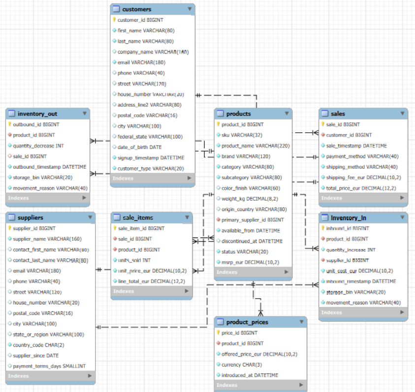
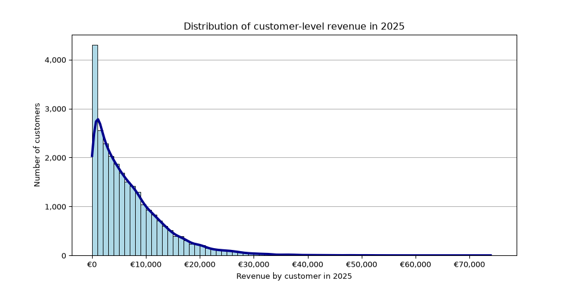
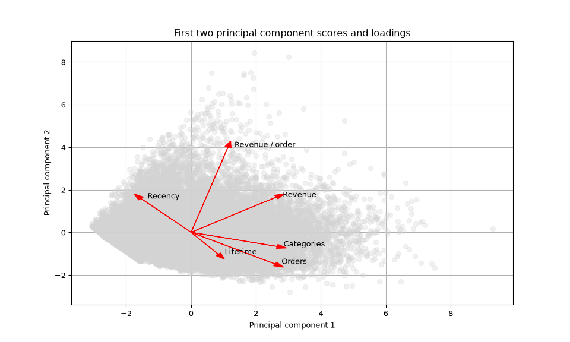
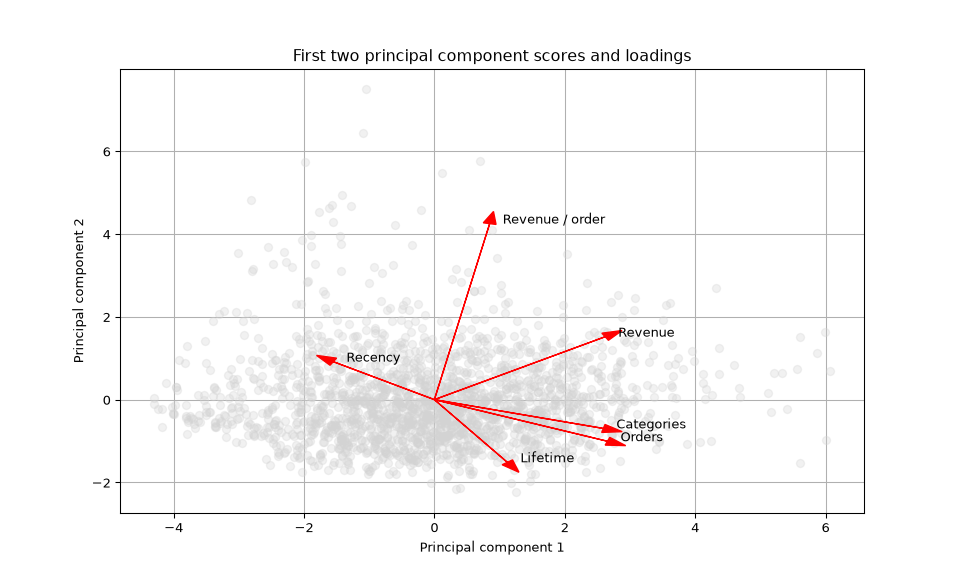
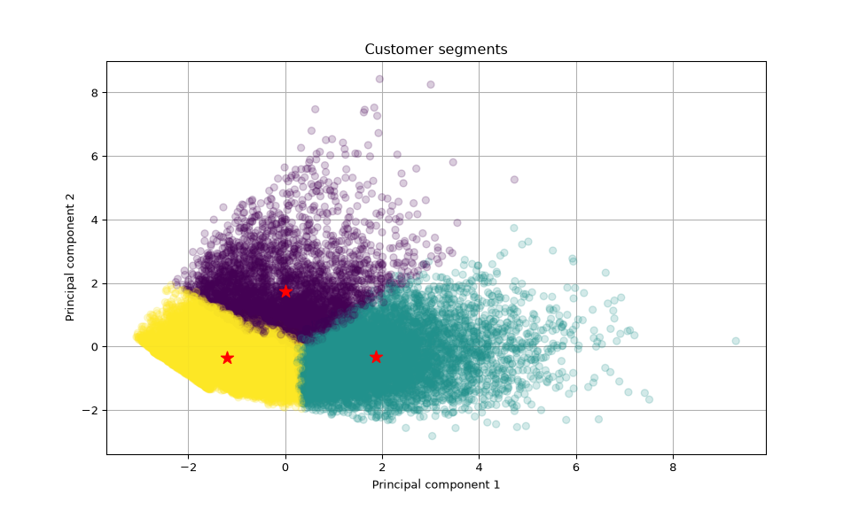
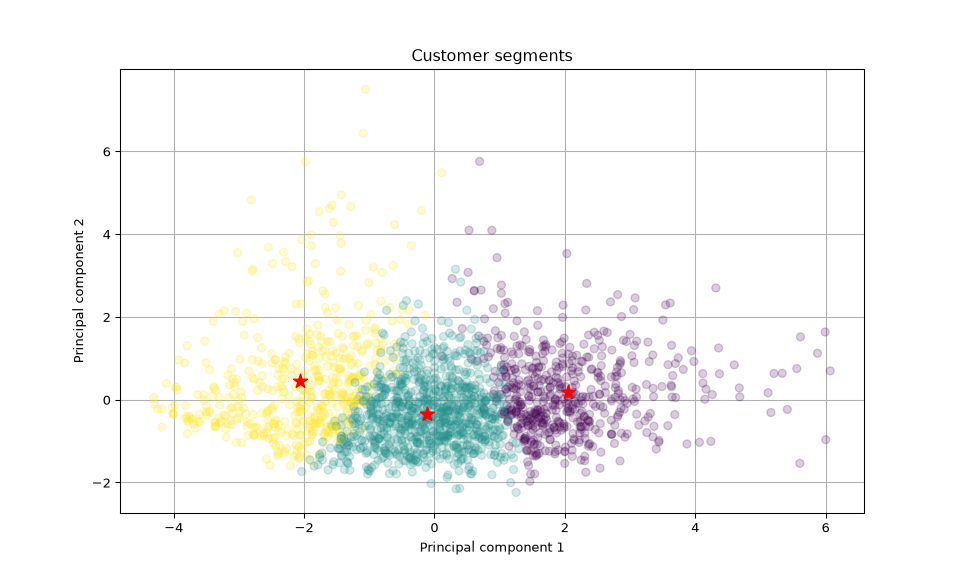
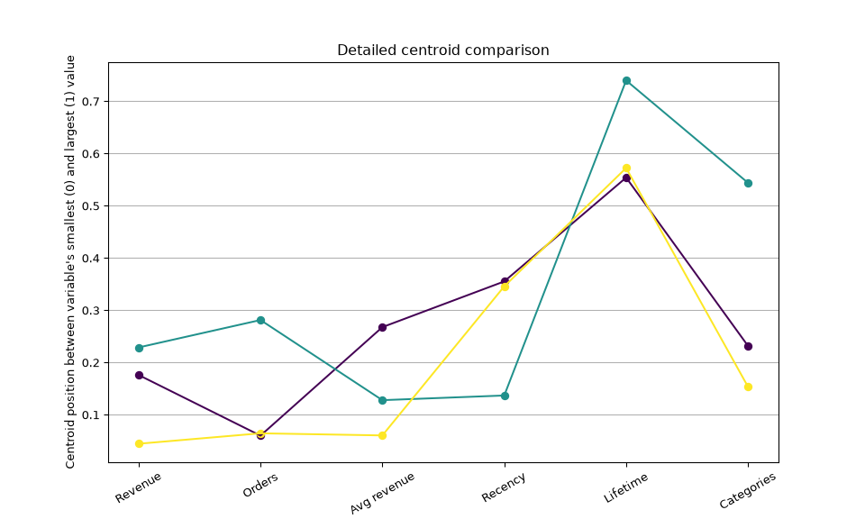
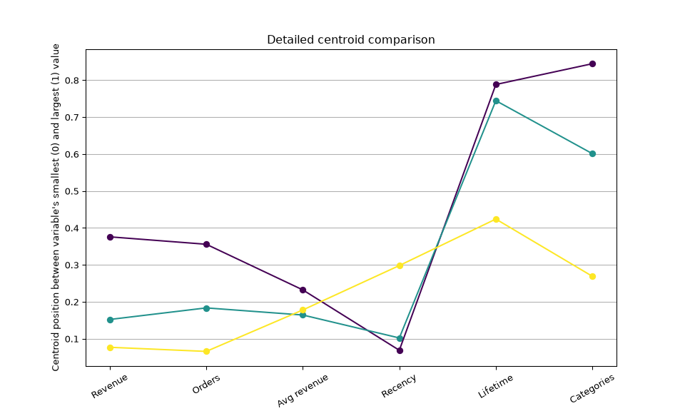
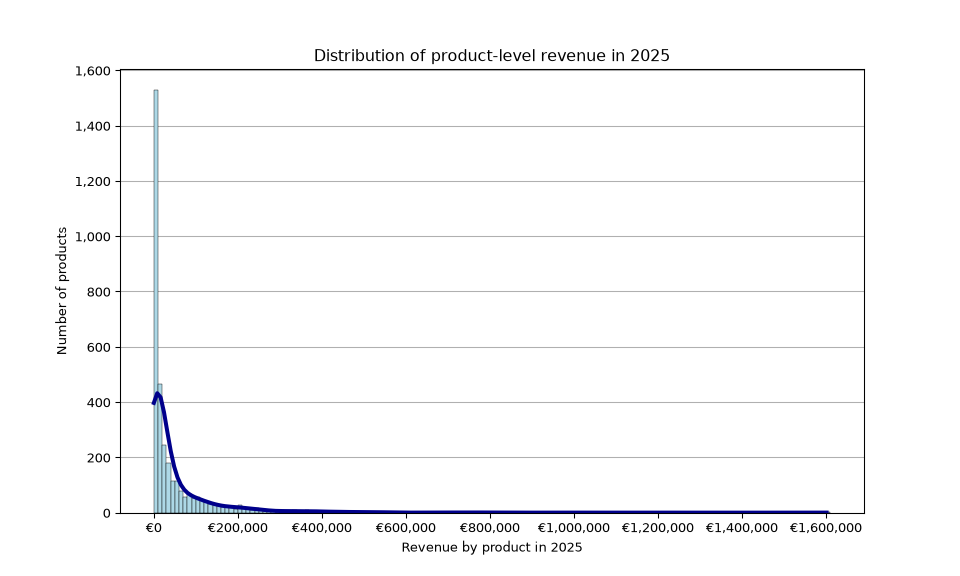

Music Retailer Sales SQL Project
================
Dominik Schulz,
October 16, 2026

- [1 Executive summary](#1-executive-summary)
- [2 Company & data information](#2-company--data-information)
- [3 Objectives](#3-objectives)
- [4 Applied tools](#4-applied-tools)
- [5 Detailed project results](#5-detailed-project-results)
  - [5.1 Revenue & sales performance](#51-revenue--sales-performance)
  - [5.2 Customer health](#52-customer-health)
  - [5.3 Product portfolio](#53-product-portfolio)
  - [5.4 Pricing](#54-pricing)

**Note:** This entire project is currently a work in progress and not
yet finished. It will be updated regularly.

# 1 Executive summary

1.  Revenue has grown, but customers are placing fewer orders per active
    customer over time. The 2024–2025 decomposition below identifies
    higher order volume as the largest arithmetic contributor to the
    increase in gross order value. Customer acquisition remains
    important, but acquisition should be complemented by retention and
    reactivation efforts. Targeted offers or a loyalty scheme could be
    tested with a holdout group, with success measured by incremental
    repeat orders and contribution margin rather than discount
    redemptions alone.

# 2 Company & data information

The company is an online retailer of musical equipment and related
items. The dataset covers the company’s sales from 2022 through 2025,
along with information on registered customers, sale items, products,
inventory movements, and related entities.

**Note:** The data used is the synthetic SQL database
`musical_retail_germany.sql` provided in my GitHub repository
[dschulz13/musical_retail_germany](https://github.com/dschulz13/musical_retail_germany).

The available data is structured as displayed in Figure
<a href="#fig:fig-struct">2.1</a>.

<div class="figure" style="text-align: center">


<p class="caption">

<span id="fig:fig-struct"></span>Figure 2.1: An overview of the
structure of the musical_retail_germany SQL database.
</p>

</div>

The database contains eight interconnected tables: `sales`,
`sale_items`, `products`, `product_prices`, `customers`, `suppliers`,
`inventory_in`, and `inventory_out`.

# 3 Objectives

The data supports, among others, four broad business topics, each with
several sub-questions. They help determining the current state of the
company at the end of the year 2025. This project aims to address the
presented questions as the analysis is developed.

1.  **Revenue & sales performance**

- How much was sold in 2025?
- How did 2025 compare with 2024?
- Is revenue growing?
- How many customers are registered, and how many orders are placed?
- What is the average order value?
- What accounts for the increase or decrease in revenue?

2.  **Customer health**

- How many active customers are there in 2025?
  - How many of them are new and how many are returning?
- How concentrated is revenue among customers?
- What does customer purchasing frequency look like?
- Are there high-value customer segments?
- Are customers becoming more or less valuable?

3.  **Product portfolio**

- Which categories/brands/products drive revenue?
- Which products are growing?
- Which products have poor sales?
- How concentrated is revenue among products?
- Which products are newly introduced?
- Which products have been discontinued?

4.  **Pricing**

- Which products experienced major price changes?
- What happened to sales volumes after price changes?
- Which products increased in price without losing much volume?
- Which products became cheaper but sold considerably more?
- Which brands/categories have the highest prices?

# 4 Applied tools

Data manipulation, calculations and table creations are performed in
[MySQL](https://www.mysql.com/de/). Graphics and unsupervised learning
techniques, used only sparingly where clearly helpful in this MySQL
project, are created with [Python](https://www.python.org/), while [R
Markdown](https://rmarkdown.rstudio.com/) is used to generate the report
and format the final table outputs.

# 5 Detailed project results

This section presents the results available so far, with tables,
figures, and corresponding recommendations. Results are organized by
topic and business question.

## 5.1 Revenue & sales performance

### 5.1.1 How much was sold in 2025?

**SQL approach for total 2025 figure**

1.  Filter `sales` to transactions recorded in 2025.
2.  Sum `total_price_eur - shipping_fee_eur` to calculate sales after
    subtracting shipping fees.

<details>

<summary>
Show code
</summary>

``` sql
# Total sales in year 2025
SELECT SUM(total_price_eur - shipping_fee_eur) AS total_sales_2025
FROM SALES
WHERE EXTRACT(YEAR FROM sale_timestamp) = 2025;
```

</details>

**SQL approach for absolute figures in Table
<a href="#tab:sales-monthly-tab">5.1</a>**

1.  Filter sales to 2025 and extract the month from each sale timestamp.
2.  Group by month and sum sales after subtracting shipping fees.
3.  Pivot the 12 monthly totals into one row with conditional
    aggregation (`MAX(CASE WHEN ...)`).

<details>

<summary>
Show code
</summary>

``` sql
# Total sales by month in year 2025 (Table 5.1, Row 1)
WITH sales_long_tab AS (
SELECT EXTRACT(MONTH FROM sale_timestamp) AS month_numb, SUM(total_price_eur - shipping_fee_eur) AS total_sales
FROM sales
WHERE EXTRACT(YEAR FROM sale_timestamp) = 2025
GROUP BY EXTRACT(MONTH FROM sale_timestamp))
SELECT
    MAX(CASE WHEN month_numb = 1 THEN total_sales END) AS January,
    MAX(CASE WHEN month_numb = 2 THEN total_sales END) AS February,
    MAX(CASE WHEN month_numb = 3 THEN total_sales END) AS March,
      MAX(CASE WHEN month_numb = 4 THEN total_sales END) AS April,
    MAX(CASE WHEN month_numb = 5 THEN total_sales END) AS May,
    MAX(CASE WHEN month_numb = 6 THEN total_sales END) AS June,    
    MAX(CASE WHEN month_numb = 7 THEN total_sales END) AS July,  
    MAX(CASE WHEN month_numb = 8 THEN total_sales END) AS August,
    MAX(CASE WHEN month_numb = 9 THEN total_sales END) AS September,
    MAX(CASE WHEN month_numb = 10 THEN total_sales END) AS October,
    MAX(CASE WHEN month_numb = 11 THEN total_sales END) AS November,
    MAX(CASE WHEN month_numb = 12 THEN total_sales END) AS December
FROM sales_long_tab;
```

</details>

**SQL approach for relative figures in Table
<a href="#tab:sales-monthly-tab">5.1</a>**

1.  Filter sales to 2025, extract the month, and calculate each month’s
    total after subtracting shipping fees.
2.  Use the sum of all monthly totals as the annual denominator.
3.  Calculate each month’s share of annual sales and format it as a
    percentage.
4.  Pivot the monthly percentages into one row for presentation.

<details>

<summary>
Show code
</summary>

``` sql
# Total sales by month in year 2025 (Table 5.1, Row 2)
WITH sales_long_tab AS (
SELECT EXTRACT(MONTH FROM sale_timestamp) AS month_numb, SUM(total_price_eur - shipping_fee_eur) AS total_sales
FROM sales
WHERE EXTRACT(YEAR FROM sale_timestamp) = 2025
GROUP BY EXTRACT(MONTH FROM sale_timestamp))
SELECT
    CONCAT(ROUND(100 * MAX(CASE WHEN month_numb = 1 THEN total_sales END) / SUM(total_sales), 2), '%') AS January,
    CONCAT(ROUND(100 * MAX(CASE WHEN month_numb = 2 THEN total_sales END) / SUM(total_sales), 2), '%') AS February,
    CONCAT(ROUND(100 * MAX(CASE WHEN month_numb = 3 THEN total_sales END) / SUM(total_sales), 2), '%') AS March,
      CONCAT(ROUND(100 * MAX(CASE WHEN month_numb = 4 THEN total_sales END) / SUM(total_sales), 2), '%') AS April,
    CONCAT(ROUND(100 * MAX(CASE WHEN month_numb = 5 THEN total_sales END) / SUM(total_sales), 2), '%') AS May,
    CONCAT(ROUND(100 * MAX(CASE WHEN month_numb = 6 THEN total_sales END) / SUM(total_sales), 2), '%') AS June,    
    CONCAT(ROUND(100 * MAX(CASE WHEN month_numb = 7 THEN total_sales END) / SUM(total_sales), 2), '%') AS July,  
    CONCAT(ROUND(100 * MAX(CASE WHEN month_numb = 8 THEN total_sales END) / SUM(total_sales), 2), '%') AS August,
    CONCAT(ROUND(100 * MAX(CASE WHEN month_numb = 9 THEN total_sales END) / SUM(total_sales), 2), '%') AS September,
    CONCAT(ROUND(100 * MAX(CASE WHEN month_numb = 10 THEN total_sales END) / SUM(total_sales), 2), '%') AS October,
    CONCAT(ROUND(100 * MAX(CASE WHEN month_numb = 11 THEN total_sales END) / SUM(total_sales), 2), '%') AS November,
    CONCAT(ROUND(100 * MAX(CASE WHEN month_numb = 12 THEN total_sales END) / SUM(total_sales), 2), '%') AS December
FROM sales_long_tab;
```

</details>

**Results**

The **net sales total** for 2025, defined here as `total_price_eur`
minus shipping fees, is **€181,162,213.59**.

Table <a href="#tab:sales-monthly-tab">5.1</a> shows monthly net sales
for 2025. October, November, and December recorded **€15,862,459.29**,
**€20,654,304.18**, and **€19,996,241.47**, respectively. Together,
these three months contributed approximately **31.2%** of annual net
sales, indicating a pronounced fourth-quarter peak.

|  | January | February | March | April | May | June | July | August | September | October | November | December |
|----|---:|---:|---:|---:|---:|---:|---:|---:|---:|---:|---:|---:|
| Absolute | €11,634,671.43 | €13,224,547.24 | €14,406,142.15 | €14,108,479.68 | €14,687,588.63 | €13,669,492.17 | €13,437,017.96 | €14,455,434.75 | €15,025,834.64 | €15,862,459.29 | €20,654,304.18 | €19,996,241.47 |
| Relative | 6.42% | 7.30% | 7.95% | 7.79% | 8.11% | 7.55% | 7.42% | 7.98% | 8.29% | 8.76% | 11.40% | 11.04% |

<span id="tab:sales-monthly-tab"></span>Table 5.1: Monthly total sales
(absolute and relative) of the year 2025.

### 5.1.2 How did 2025 compare with 2024?

**SQL approach for total 2024 figure**

1.  Filter `sales` to transactions recorded in 2024.
2.  Sum `total_price_eur - shipping_fee_eur` to calculate the comparable
    net-of-shipping sales total for 2024.

<details>

<summary>
Show code
</summary>

``` sql
# Total sales in year 2024
SELECT SUM(total_price_eur - shipping_fee_eur) AS total_sales_2024
FROM SALES
WHERE EXTRACT(YEAR FROM sale_timestamp) = 2024;
```

</details>

**SQL approach for Table <a href="#tab:sales-monthly-comp">5.2</a>**

1.  Filter transactions to 2024 and 2025, then aggregate net-of-shipping
    sales by year and month.
2.  Use `LAG()` partitioned by month to align each 2025 month with the
    corresponding 2024 value.
3.  Keep the 2025 rows and calculate absolute and relative
    year-over-year changes.
4.  Format the monetary values and percentage changes for the comparison
    table.

<details>

<summary>
Show code
</summary>

``` sql
# Monthly sales comparison between 2024 and 2025 (Table 5.2)
WITH suma_tab AS (
SELECT EXTRACT(YEAR FROM sale_timestamp) AS year_numb, EXTRACT(MONTH FROM sale_timestamp) AS month_numb, MONTHNAME(sale_timestamp) AS month_name, SUM(total_price_eur - shipping_fee_eur) AS total_sales
FROM sales
WHERE EXTRACT(YEAR FROM sale_timestamp) BETWEEN 2024 AND 2025
GROUP BY EXTRACT(YEAR FROM sale_timestamp), EXTRACT(MONTH FROM sale_timestamp), MONTHNAME(sale_timestamp)),
lag_tab AS (
SELECT year_numb, month_numb, month_name, LAG(total_sales, 1) OVER (PARTITION BY month_numb ORDER BY year_numb ASC) AS total_sales_2024, total_sales AS total_sales_2025
FROM suma_tab),
comp_tab AS (
SELECT month_name, total_sales_2024, total_sales_2025 FROM lag_tab
WHERE year_numb = 2025
ORDER BY month_numb ASC)
SELECT month_name, CONCAT('€', FORMAT(total_sales_2024, 2)) AS total_sales_2024,
    CONCAT('€', FORMAT(total_sales_2025, 2)) AS total_sales_2025,
    CASE
    WHEN total_sales_2025 - total_sales_2024 >= 0 THEN CONCAT('+€', FORMAT(total_sales_2025 - total_sales_2024, 2))
    WHEN total_sales_2025 - total_sales_2024 < 0 THEN CONCAT('-€', FORMAT(ABS(total_sales_2025 - total_sales_2024), 2))
  END AS abs_change,
  CASE
    WHEN 100 * (total_sales_2025 - total_sales_2024) / total_sales_2024 >= 0 THEN CONCAT('+', FORMAT(100 * (total_sales_2025 - total_sales_2024) / total_sales_2024, 2), '%')
    WHEN 100 * (total_sales_2025 - total_sales_2024) / total_sales_2024 < 0 THEN CONCAT('-', FORMAT(ABS(100 * (total_sales_2025 - total_sales_2024) / total_sales_2024), 2), '%')
  END AS rel_change
FROM comp_tab;
```

</details>

**Results**

Net sales totaled **€181,162,213.59** in 2025, an **increase** of
**€20,310,547.77** (**12.63%**) compared with 2024, when net sales were
**€160,851,665.82**.

| Month     |     Sales 2024 |     Sales 2025 | Absolute change | Relative change |
|:----------|---------------:|---------------:|----------------:|----------------:|
| January   | €10,662,098.53 | €11,634,671.43 |    +€972,572.90 |          +9.12% |
| February  | €12,509,612.61 | €13,224,547.24 |    +€714,934.63 |          +5.72% |
| March     | €12,716,601.72 | €14,406,142.15 |  +€1,689,540.43 |         +13.29% |
| April     | €12,951,284.01 | €14,108,479.68 |  +€1,157,195.67 |          +8.93% |
| May       | €13,269,831.06 | €14,687,588.63 |  +€1,417,757.57 |         +10.68% |
| June      | €12,281,043.47 | €13,669,492.17 |  +€1,388,448.70 |         +11.31% |
| July      | €11,909,782.25 | €13,437,017.96 |  +€1,527,235.71 |         +12.82% |
| August    | €12,686,576.47 | €14,455,434.75 |  +€1,768,858.28 |         +13.94% |
| September | €13,107,929.40 | €15,025,834.64 |  +€1,917,905.24 |         +14.63% |
| October   | €13,674,035.81 | €15,862,459.29 |  +€2,188,423.48 |         +16.00% |
| November  | €17,877,541.31 | €20,654,304.18 |  +€2,776,762.87 |         +15.53% |
| December  | €17,205,329.18 | €19,996,241.47 |  +€2,790,912.29 |         +16.22% |

<span id="tab:sales-monthly-comp"></span>Table 5.2: Monthly sales
comparison between the years 2024 and 2025.

As Table <a href="#tab:sales-monthly-comp">5.2</a> shows, net sales
increased in every month of 2025 compared with the same month in 2024.
February had the smallest relative increase (5.72%), followed by April
(8.93%) and January (9.12%). The largest relative increases occurred in
October, November, and December.

### 5.1.3 Is revenue growing?

**SQL approach for Table <a href="#tab:revenue-monthly-comp">5.3</a>**

1.  Aggregate `total_price_eur` by year and month; this query does not
    subtract shipping fees.
2.  Use windowed `LAG()` values to retrieve the same month’s revenue
    from the previous three years.
3.  For the 2025 row, calculate relative changes for 2022–2023,
    2023–2024, and 2024–2025.
4.  Return the monthly comparison in calendar order.

<details>

<summary>
Show code
</summary>

``` sql
# Total revenue increase in % by month for each year (Table 5.3)
WITH agg_tab AS (
SELECT EXTRACT(YEAR FROM sale_timestamp) AS year_numb, EXTRACT(MONTH FROM sale_timestamp) AS month_numb, MONTHNAME(sale_timestamp) AS month_name, SUM(total_price_eur) AS revenue
FROM sales
GROUP BY EXTRACT(YEAR FROM sale_timestamp), EXTRACT(MONTH FROM sale_timestamp), MONTHNAME(sale_timestamp)),
lag_tab AS (
SELECT year_numb, month_numb, month_name, LAG(revenue, 3) OVER (PARTITION BY month_numb ORDER BY year_numb ASC) AS rev_2022,
    LAG(revenue, 2) OVER (PARTITION BY month_numb ORDER BY year_numb ASC) AS rev_2023,
    LAG(revenue, 1) OVER (PARTITION BY month_numb ORDER BY year_numb ASC) AS rev_2024,
    revenue AS rev_2025
FROM agg_tab)
SELECT month_name,
  CASE
    WHEN 100 * (rev_2023 - rev_2022) / rev_2022 >= 0 THEN CONCAT('+', FORMAT(100 * (rev_2023 - rev_2022) / rev_2022, 2), '%')
    WHEN 100 * (rev_2023 - rev_2022) / rev_2022 < 0 THEN CONCAT('-', FORMAT(ABS(100 * (rev_2023 - rev_2022) / rev_2022), 2), '%')
  END AS change_22_23,
  CASE
    WHEN 100 * (rev_2024 - rev_2023) / rev_2023 >= 0 THEN CONCAT('+', FORMAT(100 * (rev_2024 - rev_2023) / rev_2023, 2), '%')
    WHEN 100 * (rev_2024 - rev_2023) / rev_2023 < 0 THEN CONCAT('-', FORMAT(ABS(100 * (rev_2024 - rev_2023) / rev_2023), 2), '%')
  END AS change_23_24,
  CASE
    WHEN 100 * (rev_2025 - rev_2024) / rev_2024 >= 0 THEN CONCAT('+', FORMAT(100 * (rev_2025 - rev_2024) / rev_2024, 2), '%')
    WHEN 100 * (rev_2025 - rev_2024) / rev_2024 < 0 THEN CONCAT('-', FORMAT(ABS(100 * (rev_2025 - rev_2024) / rev_2024), 2), '%')
  END AS change_24_25
FROM lag_tab
WHERE year_numb = 2025
ORDER BY month_numb;
```

</details>

**Results**

| Month     | Change 2022 to 2023 | Change 2023 to 2024 | Change 2024 to 2025 |
|:----------|--------------------:|--------------------:|--------------------:|
| January   |              +5.40% |              +9.52% |              +9.11% |
| February  |              +9.71% |             +10.35% |              +5.72% |
| March     |             +11.48% |              +5.01% |             +13.27% |
| April     |              +6.70% |              +7.06% |              +8.93% |
| May       |              +6.31% |              +8.90% |             +10.67% |
| June      |              +6.63% |              +9.29% |             +11.30% |
| July      |              +6.42% |             +10.13% |             +12.81% |
| August    |              +7.20% |             +11.48% |             +13.94% |
| September |              +7.87% |              +7.08% |             +14.62% |
| October   |              +8.60% |             +10.25% |             +15.99% |
| November  |              +9.28% |              +9.11% |             +15.52% |
| December  |              +6.53% |              +9.42% |             +16.21% |

<span id="tab:revenue-monthly-comp"></span>Table 5.3: Yearly relative
revenue changes by month 2022 through 2025.

Table <a href="#tab:revenue-monthly-comp">5.3</a> shows positive
year-over-year growth for every month in each comparison presented. The
growth rate accelerated from 2024 to 2025 in March through December, but
slowed in January and February. This is a change in the **growth rate**,
not a decline in revenue in those two months.

The largest acceleration was in March, when the growth rate rose from
5.01% to 13.27%—an increase of 8.26 percentage points. From September
through December, the growth rate increased by roughly five to seven
percentage points. Because this query sums `total_price_eur` without
subtracting shipping fees, these figures are not on the same
net-of-shipping basis as the sales totals in Sections 6.1.1–6.1.2.

### 5.1.4 How many registered and active customers are there?

**SQL approach for Table <a href="#tab:reg-cust-tab">5.4</a>**

1.  Assign each customer to a registration-year bucket: 2022 or earlier,
    2023, 2024, or 2025.
2.  Count registrations within each bucket.
3.  Calculate a cumulative sum across the buckets to obtain the
    registered-customer total at each year-end.
4.  Pivot the cumulative totals into one row, with one column per year.

<details>

<summary>
Show code
</summary>

``` sql
# Cumulative registered customers by year (Table 5.4)
WITH year_tab AS (
SELECT customer_id,
    CASE
        WHEN EXTRACT(YEAR FROM signup_timestamp) <= 2022 THEN 2022
        WHEN EXTRACT(YEAR FROM signup_timestamp) = 2023 THEN 2023
        WHEN EXTRACT(YEAR FROM signup_timestamp) = 2024 THEN 2024
        WHEN EXTRACT(YEAR FROM signup_timestamp) = 2025 THEN 2025
    END AS registered_by
FROM customers_cleaned),
agg_tab AS (
SELECT registered_by, COUNT(DISTINCT customer_id) AS new_registrations
FROM year_tab
GROUP BY registered_by),
sum_tab AS (
SELECT registered_by AS year, SUM(new_registrations) OVER (ORDER BY registered_by ASC) AS cum_registrations
FROM agg_tab)
SELECT
    FORMAT(MAX(CASE WHEN year = 2022 THEN cum_registrations END), 0) AS year_2022,
    FORMAT(MAX(CASE WHEN year = 2023 THEN cum_registrations END), 0) AS year_2023,
    FORMAT(MAX(CASE WHEN year = 2024 THEN cum_registrations END), 0) AS year_2024,
    FORMAT(MAX(CASE WHEN year = 2025 THEN cum_registrations END), 0) AS year_2025
FROM sum_tab;
```

</details>

**SQL approach for Table <a href="#tab:act-cust-tab">5.5</a>**

1.  Extract the sale year and customer ID from each sale.
2.  Count distinct customers with at least one sale in each year.
3.  Pivot those yearly counts into one row for 2022–2025.

<details>

<summary>
Show code
</summary>

``` sql
# Active customers by year (Table 5.5)
WITH id_tab AS (
SELECT EXTRACT(YEAR FROM sale_timestamp) AS year_numb, customer_id FROM sales),
agg_tab AS (
SELECT year_numb, COUNT(DISTINCT customer_id) AS numb_active_cust
FROM id_tab
GROUP BY year_numb)
SELECT
    FORMAT(MAX(CASE WHEN year_numb = 2022 THEN numb_active_cust END), 0) AS year_2022,
    FORMAT(MAX(CASE WHEN year_numb = 2023 THEN numb_active_cust END), 0) AS year_2023,
    FORMAT(MAX(CASE WHEN year_numb = 2024 THEN numb_active_cust END), 0) AS year_2024,
    FORMAT(MAX(CASE WHEN year_numb = 2025 THEN numb_active_cust END), 0) AS year_2025
FROM agg_tab;
```

</details>

**Results**

|   2022 |   2023 |   2024 |   2025 |
|-------:|-------:|-------:|-------:|
| 16,000 | 20,500 | 25,000 | 30,000 |

<span id="tab:reg-cust-tab"></span>Table 5.4: Cumulative number of
registered customers by year.

Table <a href="#tab:reg-cust-tab">5.4</a> shows that the
registered-customer base nearly doubled from 2022 to 2025. By the end of
2025, the platform had **30,000 registered customers**.

|   2022 |   2023 |   2024 |   2025 |
|-------:|-------:|-------:|-------:|
| 14,463 | 18,157 | 21,908 | 26,408 |

<span id="tab:act-cust-tab"></span>Table 5.5: Number of active customers
by year.

Table <a href="#tab:act-cust-tab">5.5</a> shows the number of **active
customers**, defined as customers who placed at least one order in the
corresponding year. Active customers are fewer than registered customers
in every year. The active-customer share of the registered base ranged
from **87.63%** to **90.39%**, and was **88.03%** in 2025.

### 5.1.5 What is the average order value?

**SQL approach for Table <a href="#tab:tab-average-order">5.6</a>**

1.  Group sales by calendar year and calculate the average
    `total_price_eur` per order.
2.  Pivot the four annual averages into one row and format them as euro
    amounts.

<details>

<summary>
Show code
</summary>

``` sql
# Average order value by year (Table 5.6)
WITH agg_tab AS (
SELECT EXTRACT(YEAR FROM sale_timestamp) AS year_numb, AVG(total_price_eur) AS average_order_eur
FROM sales
GROUP BY EXTRACT(YEAR FROM sale_timestamp))
SELECT
    CONCAT('€', FORMAT(MAX(CASE WHEN year_numb = 2022 THEN average_order_eur END), 2)) AS year_2022,
    CONCAT('€', FORMAT(MAX(CASE WHEN year_numb = 2023 THEN average_order_eur END), 2)) AS year_2023,
    CONCAT('€', FORMAT(MAX(CASE WHEN year_numb = 2024 THEN average_order_eur END), 2)) AS year_2024,
    CONCAT('€', FORMAT(MAX(CASE WHEN year_numb = 2025 THEN average_order_eur END), 2)) AS year_2025
FROM agg_tab;
```

</details>

**Results**

|      2022 |      2023 |      2024 |      2025 |
|----------:|----------:|----------:|----------:|
| €2,179.57 | €2,175.15 | €2,192.33 | €2,268.35 |

<span id="tab:tab-average-order"></span>Table 5.6: Yearly average order
value for years 2022 through 2025.

According to Table <a href="#tab:tab-average-order">5.6</a>, average
order value fell slightly from 2022 to 2023 and then increased in both
2024 and 2025. The 2025 average was **€2,268.35**. This calculation uses
`total_price_eur`; unlike the net sales totals earlier in this section,
it does not subtract shipping fees.

### 5.1.6 What accounts for the increase or decrease in revenue?

**SQL approach for Table <a href="#tab:tab-num-order">5.7</a>**

1.  Count the number of sales records (orders) in each year.
2.  Separately count distinct active customers per year and join those
    counts to the annual order counts.
3.  Divide orders by active customers to calculate average orders per
    active customer.
4.  Combine the order-count and order-frequency rows, then pivot the
    annual values into columns.

<details>

<summary>
Show code
</summary>

``` sql
# Yearly order counts and average orders by active customer (Table 5.7)
(WITH agg_tab AS (
SELECT EXTRACT(YEAR FROM sale_timestamp) AS sale_year, COUNT(*) AS orders_placed
FROM sales
GROUP BY EXTRACT(YEAR FROM sale_timestamp))
SELECT
    FORMAT(MAX(CASE WHEN sale_year = 2022 THEN orders_placed END), 0) AS year_2022,
    FORMAT(MAX(CASE WHEN sale_year = 2023 THEN orders_placed END), 0) AS year_2023,
    FORMAT(MAX(CASE WHEN sale_year = 2024 THEN orders_placed END), 0) AS year_2024,
    FORMAT(MAX(CASE WHEN sale_year = 2025 THEN orders_placed END), 0) AS year_2025
FROM agg_tab)
UNION ALL
(WITH agg_tab2 AS (
SELECT tab1.year_numb AS year_numb, ROUND(tab2.orders_placed / tab1.active_cust_count, 2) AS orders_per_capita
FROM (
SELECT EXTRACT(YEAR FROM sale_timestamp) AS year_numb, COUNT(DISTINCT customer_id) AS active_cust_count
FROM sales
GROUP BY EXTRACT(YEAR FROM sale_timestamp)) AS tab1
INNER JOIN (
SELECT EXTRACT(YEAR FROM sale_timestamp) AS sale_year, COUNT(*) AS orders_placed
FROM sales
GROUP BY EXTRACT(YEAR FROM sale_timestamp)) AS tab2 ON tab1.year_numb = tab2.sale_year)
SELECT
    MAX(CASE WHEN year_numb = 2022 THEN orders_per_capita END) AS year_2022,
    MAX(CASE WHEN year_numb = 2023 THEN orders_per_capita END) AS year_2023,
    MAX(CASE WHEN year_numb = 2024 THEN orders_per_capita END) AS year_2024,
    MAX(CASE WHEN year_numb = 2025 THEN orders_per_capita END) AS year_2025
FROM agg_tab2);
```

</details>

**SQL approach for Table <a href="#tab:tab62">5.8</a>**

1.  Select 2025 sales and join them to customer records, grouping
    customers by whether they registered before 2025 or during 2025.
2.  For each registration group, calculate order count, total
    `total_price_eur`, and average order value.
3.  Separately count distinct active customers in each registration
    group.
4.  Join the summaries and calculate orders per active customer; format
    the monetary and count fields for the table.

<details>

<summary>
Show code
</summary>

``` sql
# Order count, average orders by active customer, total revenue,
# and average order value by active customer for customers registered
# before and in 2025 (Table 5.8)
WITH joined_tab AS (
SELECT tab1.signup_year, tab2.numb_act_cust, tab1.order_count, tab1.revenue, tab1.eur_per_order FROM (
WITH comb_tab AS (
SELECT sa.sale_id, sa.customer_id, 
    CASE
        WHEN EXTRACT(YEAR FROM c.signup_timestamp) <= 2024 THEN 'before 2025'
        WHEN EXTRACT(YEAR FROM c.signup_timestamp) = 2025 THEN 'in 2025'
    END AS signup_year,
    sa.total_price_eur
FROM sales AS sa
INNER JOIN customers AS c ON sa.customer_id = c.customer_id
WHERE EXTRACT(YEAR FROM sa.sale_timestamp) = 2025)
SELECT signup_year, COUNT(*) AS order_count, SUM(total_price_eur) AS revenue, SUM(total_price_eur) / COUNT(*) AS eur_per_order
FROM comb_tab
GROUP BY signup_year) AS tab1
INNER JOIN (
WITH c2tab AS (
SELECT sa.customer_id,
    CASE
        WHEN EXTRACT(YEAR FROM c.signup_timestamp) <= 2024 THEN 'before 2025'
        WHEN EXTRACT(YEAR FROM c.signup_timestamp) = 2025 THEN 'in 2025'
    END AS signup_year
FROM sales AS sa
INNER JOIN customers AS c ON sa.customer_id = c.customer_id
WHERE EXTRACT(YEAR FROM sa.sale_timestamp) = 2025)
SELECT signup_year, COUNT(DISTINCT customer_id) AS numb_act_cust
FROM c2tab
GROUP BY signup_year) AS tab2 ON tab1.signup_year = tab2.signup_year)
SELECT signup_year, FORMAT(order_count, 0) AS order_count, ROUND(order_count / numb_act_cust, 2) AS orders_per_capita,
    CONCAT('€', FORMAT(revenue, 2)) AS revenue, CONCAT('€', FORMAT(eur_per_order, 2)) AS value_per_order
FROM joined_tab;
```

</details>

**Results**

|                   |   2022 |   2023 |   2024 |   2025 |
|-------------------|-------:|-------:|-------:|-------:|
| Number of orders  | 63,000 | 68,000 | 73,500 | 80,000 |
| Orders per capita |   4.36 |   3.75 |   3.35 |   3.03 |

<span id="tab:tab-num-order"></span>Table 5.7: Yearly order counts and
average orders per active customer.

| Signup year | Order count | Orders per capita | Revenue | Average order value |
|:---|---:|---:|---:|---:|
| before 2025 | 72,301 | 3.23 | €164,052,186.74 | €2,269.02 |
| in 2025 | 7,699 | 1.92 | €17,415,849.65 | €2,262.09 |

<span id="tab:tab62"></span>Table 5.8: Distinction between existing and
new customers in 2025.

Table <a href="#tab:tab-num-order">5.7</a> shows that the **number of
orders** increased each year, while the **average number of orders per
active customer** declined from 4.36 in 2022 to 3.03 in 2025.
Multiplying order frequency by average order value gives an approximate
annual order value per active customer of **€6,873.10** in 2025, down
from **€7,344.31** in 2024. The active-customer share of the registered
base was broadly stable. These figures suggest that growth is associated
with a larger customer base and more orders overall, but they do not by
themselves establish how much of the increase was caused by new
registrations.

Using the rounded order counts and average order values, the estimated
increase in **gross order value** from 2024 to 2025 is
**€20,331,745.00**. If average order value had remained at its 2024
level, the increase in order count would account for **€14,250,145.00**
of the increase. If order count had remained at its 2024 level, the
higher average order value would account for **€5,587,470.00**. The
remaining **€494,130.00** is the interaction between the two changes. On
this decomposition, higher order volume is the largest arithmetic
contributor. Note that this calculation uses `total_price_eur` and
rounded averages, whereas the headline sales totals subtract shipping
fees; the resulting amounts are therefore not directly comparable and
may not reconcile exactly.

Table <a href="#tab:tab62">5.8</a> shows that customers registered
before 2025 generated **€164,052,186.74** in gross order value during
2025, compared with **€17,415,849.65** from customers who registered
during 2025. These figures are useful for describing the 2025 cohorts,
but they should not be directly compared with the 2024 net sales total
because the definitions differ. The newer registration cohort recorded
fewer orders per active customer, which may partly reflect its shorter
time on the platform.

Customer acquisition is valuable, but sustained growth also depends on
retention. The company should test ways to **reactivate lapsed
customers** and increase repeat purchases among active customers.
Options include targeted discounts for lapsed or long-standing customers
and a loyalty programme that rewards repeat orders. A controlled pilot
with a holdout group would help determine whether these interventions
create incremental orders and margin, rather than simply discounting
purchases that would have happened anyway.

## 5.2 Customer health

### 5.2.1 How many active customers are there in 2025?

**Sub-question:** How many of them are new and how many are returning?

**SQL approach for Table <a href="#tab:tab7">5.9</a>**

1.  Number each customer’s purchases chronologically across the full
    sales history.
2.  Keep the customer’s 2025 purchases and classify the customer as new
    if their first-ever purchase is in 2025, otherwise as returning.
3.  Count customers in each group and calculate each group’s percentage
    of all active customers in 2025.
4.  Return absolute counts and relative shares as two rows.

<details>

<summary>
Show code
</summary>

``` sql
# Number of new and returning customers in 2025 (Table 5.9)
WITH agg_tab AS (
SELECT customer_id, ROW_NUMBER() OVER (PARTITION BY customer_id ORDER BY sale_timestamp ASC) AS nr_purchase, EXTRACT(YEAR FROM sale_timestamp) AS sale_year
FROM sales),
type_tab AS (
SELECT customer_id,
    CASE
        WHEN MIN(nr_purchase) = 1 THEN 'new'
        ELSE 'returning'
    END AS customer_type
FROM agg_tab
WHERE sale_year = 2025
GROUP BY customer_id),
count_tab AS (
SELECT customer_type, COUNT(*) AS customer_count
FROM type_tab
GROUP BY customer_type),
abs_tab AS (
SELECT
    MAX(CASE WHEN customer_type = 'returning' THEN customer_count END) AS returning_cust,
    MAX(CASE WHEN customer_type = 'new' THEN customer_count END) AS new_cust
FROM count_tab)
(SELECT
    FORMAT(returning_cust, 0) AS 'Returning',
    FORMAT(new_cust, 0) AS 'New',
    FORMAT(returning_cust + new_cust, 0) AS 'Total'
FROM abs_tab)
UNION ALL
(SELECT
    CONCAT(ROUND(100 * returning_cust / (returning_cust + new_cust), 2), '%') AS 'Returning',
    CONCAT(ROUND(100 * new_cust / (returning_cust + new_cust), 2), '%') AS 'New',
    '100.00%' AS 'Total'
FROM abs_tab);
```

</details>

**Results**

|          | Returning |    New |   Total |
|----------|----------:|-------:|--------:|
| Absolute |    20,789 |  5,619 |  26,408 |
| Relative |    78.72% | 21.28% | 100.00% |

<span id="tab:tab7"></span>Table 5.9: New and returning customers in
2025.

Table <a href="#tab:tab7">5.9</a> shows **26,408 active customers** in
2025, defined as customers who placed at least one order during the
year. A **new customer** is one whose first-ever purchase occurred in
2025, regardless of registration date. On this basis, **5,619 customers
(21.28%)** were new buyers and **20,789 (78.72%)** were returning
buyers.

### 5.2.2 How concentrated is revenue among customers?

**SQL approach for Table <a href="#tab:tab8">5.10</a>**

1.  Construct revenue intervals in €5,000 steps, with an upper limit of
    €75,000.
2.  Sum each customer’s `total_price_eur` across 2025 sales.
3.  Assign each customer to the interval containing their 2025 revenue
    and count customers by interval.
4.  Calculate each interval’s share of the customers included in the
    grouped results and order the intervals from low to high.

<details>

<summary>
Show code
</summary>

``` sql
# Revenue concentration among active customers in 2025 (Table 5.10)
WITH pre_tab AS (
SELECT f.thousands + g.tthousands AS lower_bound, LEAD(f.thousands + g.tthousands) OVER (ORDER BY f.thousands + g.tthousands ASC) AS upper_bound
FROM (
SELECT 0 AS thousands
UNION ALL SELECT 5000
) AS f
CROSS JOIN (
SELECT 0 AS tthousands
UNION ALL SELECT 10000
UNION ALL SELECT 20000
UNION ALL SELECT 30000
UNION ALL SELECT 40000
UNION ALL SELECT 50000
UNION ALL SELECT 60000
UNION ALL SELECT 70000
UNION ALL SELECT 80000
UNION ALL SELECT 90000
) AS g
ORDER BY f.thousands + g.tthousands ASC),
group_tab AS (
SELECT lower_bound, upper_bound - 0.01 AS upper_bound, CONCAT('[€', FORMAT(lower_bound, 0), ', €', FORMAT(upper_bound, 0), ')') AS category
FROM pre_tab
WHERE upper_bound <= 75000),
sale_tab AS (
SELECT customer_id, SUM(total_price_eur) AS revenue
FROM sales
WHERE EXTRACT(YEAR FROM sale_timestamp) = 2025
GROUP BY customer_id),
comb_tab AS (
SELECT st.customer_id, st.revenue, gt.category, gt.lower_bound AS lower_bound
FROM sale_tab AS st
INNER JOIN group_tab AS gt ON st.revenue BETWEEN gt.lower_bound AND gt.upper_bound),
pre_final AS (
SELECT category, COUNT(*) AS cust_count, lower_bound
FROM comb_tab
GROUP BY category, lower_bound)
SELECT category, FORMAT(cust_count, 0), CONCAT(FORMAT(100 * cust_count / (SUM(cust_count) OVER ()), 2), '%') AS rel
FROM pre_final
ORDER BY lower_bound;
```

</details>

**Results:**

| Revenue interval    | Customer count | Relative |
|:--------------------|---------------:|---------:|
| \[€0, €5,000)       |         13,044 |   49.39% |
| \[€5,000, €10,000)  |          6,952 |   26.33% |
| \[€10,000, €15,000) |          3,584 |   13.57% |
| \[€15,000, €20,000) |          1,555 |    5.89% |
| \[€20,000, €25,000) |            687 |    2.60% |
| \[€25,000, €30,000) |            331 |    1.25% |
| \[€30,000, €35,000) |            129 |    0.49% |
| \[€35,000, €40,000) |             64 |    0.24% |
| \[€40,000, €45,000) |             25 |    0.09% |
| \[€45,000, €50,000) |             16 |    0.06% |
| \[€50,000, €55,000) |             11 |    0.04% |
| \[€55,000, €60,000) |              4 |    0.02% |
| \[€60,000, €65,000) |              2 |    0.01% |
| \[€65,000, €70,000) |              3 |    0.01% |
| \[€70,000, €75,000) |              1 |    0.00% |

<span id="tab:tab8"></span>Table 5.10: Active customers in 2025 by 2025
revenue.

Table <a href="#tab:tab8">5.10</a> shows 2025 revenue per active
customer grouped into revenue intervals. These amounts use
`total_price_eur`, so they are not directly comparable with the
net-of-shipping sales totals reported earlier. The distribution is
strongly right-skewed: **49.39%** of active customers generated less
than **€5,000**, and approximately **75.72%** generated less than
**€10,000**. Only **0.08%** generated at least **€50,000**. The query’s
displayed intervals stop below €75,000, so confirm that the data contain
no customers at or above that threshold before treating the table as
exhaustive.

<div class="figure" style="text-align: center">


<p class="caption">

<span id="fig:fig-dist-rev"></span>Figure 5.1: Histogram and kernel
density estimate of customer-level revenue in 2025.
</p>

</div>

Figure <a href="#fig:fig-dist-rev">5.1</a>, created in Python, combines
a histogram of customer-level revenue in 2025 with a kernel density
estimate. The plot makes the distribution’s strong right skew and long
upper tail easier to see.

### 5.2.3 What does customer purchasing frequency look like?

**SQL approach for Table <a href="#tab:tab9">5.11</a>**

1.  Use `LAG()` to find each customer’s previous sale timestamp and
    calculate the elapsed time in days.
2.  Keep order intervals associated with sales made in 2025.
3.  Build 100-day intervals from 0 through 1,399 days and assign each
    eligible order interval to a bin.
4.  Count intervals in each bin and calculate their percentage of all
    intervals included in the bins.

<details>

<summary>
Show code
</summary>

``` sql
# Number of orders in 2025 by days since the previous purchase (Table 5.11)
WITH time_tab AS (
SELECT customer_id, sale_timestamp, TIMESTAMPDIFF(SECOND, LAG(sale_timestamp, 1) OVER (PARTITION BY customer_id ORDER BY sale_timestamp ASC), sale_timestamp) / 86400.0 AS days_since_last_purch
FROM sales
ORDER BY customer_id, sale_timestamp),
freq_tab AS (
SELECT customer_id, days_since_last_purch
FROM time_tab
WHERE EXTRACT(YEAR FROM sale_timestamp) = 2025),
pre_group AS (
SELECT hund_tab.hundreds + thous_tab.thousands AS lower_bound, 
    LEAD(hund_tab.hundreds + thous_tab.thousands, 1) OVER (ORDER BY hund_tab.hundreds + thous_tab.thousands) AS upper_bound
FROM (
SELECT 0 AS hundreds
UNION ALL SELECT 100
UNION ALL SELECT 200
UNION ALL SELECT 300
UNION ALL SELECT 400
UNION ALL SELECT 500
UNION ALL SELECT 600
UNION ALL SELECT 700
UNION ALL SELECT 800
UNION ALL SELECT 900
) AS hund_tab
CROSS JOIN (
SELECT 0 AS thousands
UNION ALL SELECT 1000
) AS thous_tab
ORDER BY  hund_tab.hundreds + thous_tab.thousands ASC),
group_tab AS (
SELECT lower_bound, upper_bound - 1 AS upper_bound, CONCAT('between ', lower_bound, ' and ', upper_bound - 1) AS category
FROM pre_group
WHERE upper_bound <= 1400),
count_tab AS (
SELECT gt.category, gt.lower_bound
FROM freq_tab AS ft
INNER JOIN group_tab AS gt ON ft.days_since_last_purch >= gt.lower_bound AND ft.days_since_last_purch < gt.upper_bound + 1),
pre_final AS (
SELECT category, COUNT(*) AS order_count, lower_bound
FROM count_tab
GROUP BY category, lower_bound
ORDER BY lower_bound)
SELECT category, FORMAT(order_count, 0) AS abs, CONCAT(FORMAT(100 * order_count / SUM(order_count) OVER (), 2), '%') AS rel
FROM pre_final;
```

</details>

**Results**

| Days since last purchase | Order count | Relative |
|:-------------------------|------------:|---------:|
| between 0 and 99         |      45,988 |   61.83% |
| between 100 and 199      |      15,884 |   21.35% |
| between 200 and 299      |       6,714 |    9.03% |
| between 300 and 399      |       3,092 |    4.16% |
| between 400 and 499      |       1,403 |    1.89% |
| between 500 and 599      |         681 |    0.92% |
| between 600 and 699      |         307 |    0.41% |
| between 700 and 799      |         155 |    0.21% |
| between 800 and 899      |          72 |    0.10% |
| between 900 and 999      |          48 |    0.06% |
| between 1000 and 1099    |          25 |    0.03% |
| between 1100 and 1199    |           9 |    0.01% |
| between 1200 and 1299    |           1 |    0.00% |
| between 1300 and 1399    |           2 |    0.00% |

<span id="tab:tab9"></span>Table 5.11: Order counts in 2025 by days
since last purchase.

Among the order intervals assigned to the reported bins, **61.83%** fell
within 99 days of the previous purchase and **83.18%** within 199 days.
**3.63%** fell into bins of 400 days or more; this should not be
described as the share taking more than a year, because the 300–399-day
bin straddles the one-year mark. The table counts order intervals, not
unique customers: the 37 observations at 1,000 days or more should
therefore be described as **orders**, not customers. Overall,
repeat-purchase intervals are strongly right-skewed.

### 5.2.4 Are there high-value customer segments?

**SQL approach for Table <a href="#tab:tab10">5.12</a>**

1.  Aggregate 2025 revenue and order count separately for each customer.
2.  Calculate recency and time since first purchase relative to January
    01, 2026 (taken as the current time point).
3.  Join sales to sale items and product data to count distinct
    categories purchased by each customer in 2025.
4.  Join those features to the cleaned customer type, calculate revenue
    shares and average revenue per order, then return the 20
    highest-revenue customers.

<details>

<summary>
Show code
</summary>

``` sql
# Key features of top 20 customers by revenue in 2025 (Table 5.12)
WITH rev_tab AS (
SELECT customer_id, SUM(total_price_eur) AS revenue
FROM sales
WHERE EXTRACT(YEAR FROM sale_timestamp) = 2025
GROUP BY customer_id
ORDER BY SUM(total_price_eur) DESC),
ord_tab AS (
SELECT customer_id, COUNT(*) AS order_count
FROM sales
WHERE EXTRACT(YEAR FROM sale_timestamp) = 2025
GROUP BY customer_id
ORDER BY COUNT(*) DESC),
recency_tab AS (
SELECT customer_id, TIMESTAMPDIFF(SECOND, MAX(sale_timestamp), '2026-01-01 00:00:00') / 86400.0 AS recency
FROM sales
WHERE EXTRACT(YEAR FROM sale_timestamp) = 2025
GROUP BY customer_id),
cust_id_2025 AS (
SELECT DISTINCT customer_id
FROM sales
WHERE EXTRACT(YEAR FROM sale_timestamp) = 2025
),
first_tab AS (
    SELECT cid.customer_id, stab.time_since_first_purch
    FROM cust_id_2025 AS cid
    LEFT JOIN (
        SELECT customer_id, TIMESTAMPDIFF(SECOND, MIN(sale_timestamp), '2026-01-01 00:00:00') / 86400.0 AS time_since_first_purch
        FROM sales
        GROUP BY customer_id
    ) AS stab ON cid.customer_id = stab.customer_id),
cat_pre AS (
SELECT s1.customer_id, s3.category
FROM sales AS s1
INNER JOIN sale_items AS s2 ON s1.sale_id = s2.sale_id
LEFT JOIN products AS s3 ON s2.product_id = s3.product_id
WHERE EXTRACT(YEAR FROM s1.sale_timestamp) = 2025),
cat_final AS (
SELECT customer_id, COUNT(DISTINCT category) AS category_count
FROM cat_pre
GROUP BY customer_id)
SELECT rt.customer_id, CONCAT('€', FORMAT(rt.revenue, 2)) AS revenue,
    CONCAT(FORMAT(100 * rt.revenue / (SUM(rt.revenue) OVER ()), 2), '%') AS perc,
    FORMAT(ot.order_count, 0) AS order_count, CONCAT('€', FORMAT(rt.revenue / ot.order_count, 2)) AS average_rev_per_order, cc.customer_type,
    FORMAT(rec_tab.recency, 2) AS recency, FORMAT(ft.time_since_first_purch, 2) AS time_since_first_purch, ct.category_count
FROM rev_tab AS rt
INNER JOIN ord_tab AS ot ON rt.customer_id = ot.customer_id
INNER JOIN customers_cleaned AS cc ON rt.customer_id = cc.customer_id
INNER JOIN recency_tab AS rec_tab ON rt.customer_id = rec_tab.customer_id
INNER JOIN first_tab AS ft ON rt.customer_id = ft.customer_id
INNER JOIN cat_final AS ct ON rt.customer_id = ct.customer_id
ORDER BY rt.revenue DESC
LIMIT 20;
```

</details>

**Results**

| Customer ID | Total revenue | Relative revenue | Order count | Average revenue per order | Customer type | Days since last purchase | Days since first purchase | Product categories |
|---:|---:|---:|---:|---:|---:|---:|---:|---:|
| 13597 | €73,936.02 | 0.04% | 19 | €3,891.37 | business | 34.43 | 1,283.34 | 9 |
| 7188 | €68,869.68 | 0.04% | 22 | €3,130.44 | business | 2.54 | 1,427.33 | 8 |
| 10773 | €68,352.92 | 0.04% | 17 | €4,020.76 | business | 16.43 | 1,442.57 | 9 |
| 21762 | €68,133.97 | 0.04% | 22 | €3,097.00 | business | 4.45 | 591.21 | 9 |
| 8195 | €62,537.72 | 0.03% | 19 | €3,291.46 | business | 6.36 | 1,399.58 | 9 |
| 2490 | €60,087.47 | 0.03% | 19 | €3,162.50 | business | 25.55 | 1,430.33 | 9 |
| 6827 | €59,359.82 | 0.03% | 19 | €3,124.20 | business | 43.56 | 1,450.29 | 9 |
| 6671 | €57,768.30 | 0.03% | 16 | €3,610.52 | business | 69.53 | 1,412.60 | 8 |
| 9104 | €57,288.53 | 0.03% | 10 | €5,728.85 | business | 10.21 | 1,452.39 | 9 |
| 3633 | €55,129.13 | 0.03% | 11 | €5,011.74 | business | 37.59 | 1,432.21 | 7 |
| 1313 | €53,967.22 | 0.03% | 19 | €2,840.38 | business | 3.30 | 1,451.49 | 9 |
| 24930 | €53,718.34 | 0.03% | 19 | €2,827.28 | business | 1.41 | 347.43 | 9 |
| 6300 | €53,535.55 | 0.03% | 22 | €2,433.43 | business | 14.36 | 1,432.35 | 9 |
| 12403 | €52,805.53 | 0.03% | 17 | €3,106.21 | business | 32.46 | 1,377.31 | 8 |
| 19151 | €52,045.45 | 0.03% | 11 | €4,731.40 | business | 7.37 | 816.28 | 8 |
| 5387 | €51,136.08 | 0.03% | 27 | €1,893.93 | business | 4.45 | 1,427.28 | 9 |
| 24902 | €50,688.00 | 0.03% | 13 | €3,899.08 | business | 42.45 | 350.60 | 9 |
| 3092 | €50,628.83 | 0.03% | 21 | €2,410.90 | business | 9.22 | 1,458.44 | 9 |
| 8579 | €50,591.70 | 0.03% | 17 | €2,975.98 | business | 1.36 | 1,422.55 | 9 |
| 9543 | €50,522.10 | 0.03% | 13 | €3,886.32 | business | 6.32 | 1,433.34 | 8 |

<span id="tab:tab10"></span>Table 5.12: Top 20 customers in 2025 by
revenue.

Table <a href="#tab:tab10">5.12</a> summarizes the 20 customers with the
highest 2025 revenue. All are classified as business customers in the
cleaned data, and most placed multiple orders across several product
categories. Many have been purchasing from the company for more than
1,000 days. Each contributed approximately **0.03%–0.04%** of total 2025
customer revenue, so no single customer dominates this measure. Note
that revenue alone does not establish profitability; assessing margins
or service costs would be needed before calling these customers the most
profitable. A next step is to segment the broader customer base using
engagement and spending features. For this purpose, we employ principal
component analysis (PCA) and clustering techniques in Python.

<details>

<summary>
Python code
</summary>

``` python
# Import relevant libraries
import pandas as pd
from sklearn.preprocessing import StandardScaler as SC
from sklearn.cluster import KMeans
from sklearn.pipeline import Pipeline
from sklearn.decomposition import PCA
import matplotlib.pyplot as plt
import matplotlib.colors as mcolors

### K-Means wrapper for relevant results

def kmeans(data, n_clusters):
  
  # Pipeline
  kmeans_pipeline = Pipeline([
    ('scaler', SC(with_std = True, with_mean = True)),
    ('kmeans', KMeans(n_clusters = 3, random_state = 1, n_init = 100))
  ])
  
  # Data to numpy
  X = data.to_numpy()
  
  # Fit
  clust_fit = kmeans_pipeline.fit(X)
  centroids = clust_fit.named_steps['kmeans'].cluster_centers_
  labels = clust_fit.predict(X)
  
  return {'fit_obj': clust_fit, 'centroids': centroids, 'labels': labels}

### PCA wrapper

def pca(data):
  
  pca_pipeline = Pipeline([
    ('scaler', SC(with_mean = True, with_std = True)),
    ('pca_est', PCA())
  ])
  
  pca_fit = pca_pipeline.fit(data)
  scores = pca_fit.transform(data)
  loadings = pca_fit.named_steps['pca_est'].components_
  
  return {'fit_obj': pca_fit, 'scores': scores, 'loadings': loadings}


### PCA for visualization

def pca_clust_plot(clust_fit, pca_fit):
  
  scores = pca_fit['scores']
  centroids = pca_fit['fit_obj'].named_steps['pca_est'].transform(clust_fit['centroids'])
  
  pc1 = scores[:, 0]
  pc2 = scores[:, 1]
  
  fig, ax = plt.subplots(1, 1, figsize = (10, 6))
  ax.scatter(pc1, pc2, c = clust_fit['labels'], alpha = 0.2);
  ax.scatter(centroids[:, 0], centroids[:, 1], c = 'red', marker = '*', s = 120);
  ax.set_xlabel('Principal component 1');
  ax.set_ylabel('Principal component 2');
  ax.set_title('Customer segments');
  ax.grid(axis = 'x');
  ax.grid(axis = 'y');
  ax.set_axisbelow(True);

### Biplot of PCA

def biplot(scores, loadings, s = 4):
  fig, ax = plt.subplots(1, 1, figsize = (10, 6))
  ax.scatter(scores[:, 0], scores[:, 1], color = '#D3D3D3', alpha = 0.3);
  
  nams = ['Revenue', 'Orders', 'Revenue / order', 'Recency', 'Lifetime', 'Categories']
  
  dim = loadings.shape[1]
  
  for k in range(dim):
    ax.arrow(0, 0, s * loadings[0, k], s * loadings[1, k], color = 'red', head_width = 0.2);
    ax.text(s * loadings[0, k] + 0.2, s * loadings[1, k], nams[k], color = 'black');
  
  ax.set_xlabel('Principal component 1');
  ax.set_ylabel('Principal component 2');
  ax.set_title('First two principal component scores and loadings');
  ax.grid(axis = 'x');
  ax.grid(axis = 'y');
  ax.set_axisbelow(True);

### Centroid plot

def centroid_plot(clust_fit, data):
  cluster_centers = clust_fit['centroids'].copy()

  cluster_centers_rescaled = clust_fit['fit_obj'].named_steps['scaler'].inverse_transform(cluster_centers)

  cluster_centers_sc = cluster_centers_rescaled.copy()
  
  ncol = data.shape[1]

  for i in range(0, ncol):
    minv = data.iloc[:, i].min()
    maxv = data.iloc[:, i].max()
    cluster_centers_sc[:, i] = (cluster_centers_rescaled[:, i] - minv) / (maxv - minv)


  cmap = plt.colormaps['viridis']
  norm = mcolors.Normalize(vmin = 0, vmax = 2)
  color_0 = cmap(norm(0))
  color_1 = cmap(norm(1))
  color_2 = cmap(norm(2))

  x = np.arange(1, ncol + 1, 1)
  fig, ax = plt.subplots(1, 1, figsize = (10, 6))
  ax.plot(x, cluster_centers_sc[0, :], color = color_0);
  ax.scatter(x, cluster_centers_sc[0, :], color = color_0);
  ax.plot(x, cluster_centers_sc[1, :], color = color_1);
  ax.scatter(x, cluster_centers_sc[1, :], color = color_1);
  ax.plot(x, cluster_centers_sc[2, :], color = color_2);
  ax.scatter(x, cluster_centers_sc[2, :], color = color_2);
  ax.set_xticks(x, labels = ['Revenue', 'Orders', 'Avg revenue', 'Recency', 'Lifetime', 'Categories'], rotation = 30);
  ax.set_ylabel("Centroid position between variable's smallest (0) and largest (1) value");
  ax.set_title('Detailed centroid comparison');
  ax.grid(axis = 'y');
  ax.set_axisbelow(True);

### Application to private customers

data_cust = r.sql_q10_2
data_cust_private = data_cust[data_cust['customer_type'] == 'private'].copy()
data_cust_private_red = data_cust_private.drop(['customer_id', 'customer_type', 'perc'], axis = 1)

clust_fit_priv = kmeans(data_cust_private_red, n_clusters = 3)
pca_fit_priv = pca(data_cust_private_red)

### Application to business customers

data_cust_bus = data_cust[data_cust['customer_type'] == 'business'].copy()
data_cust_bus_red = data_cust_bus.drop(['customer_id', 'customer_type', 'perc'], axis = 1)

clust_fit_bus = kmeans(data_cust_bus_red, n_clusters = 3)
pca_fit_bus = pca(data_cust_bus_red)
```

``` python
# Biplots
biplot(scores = pca_fit_priv['scores'], loadings = pca_fit_priv['loadings'], s = 5)
biplot(scores = pca_fit_bus['scores'], loadings = pca_fit_bus['loadings'], s = 5)

# Plots of PC1 vs. PC2 with clusters
pca_clust_plot(clust_fit_priv, pca_fit_priv)
pca_clust_plot(clust_fit_bus, pca_fit_bus)

# Plots of centroids for original variables
centroid_plot(clust_fit_priv, data_cust_private_red)
centroid_plot(clust_fit_bus, data_cust_bus_red)
```

</details>

<div class="figure" style="text-align: center">


<p class="caption">

<span id="fig:biplot-private"></span>Figure 5.2: Biplot of PCA applied
to private customer data.
</p>

</div>

<div class="figure" style="text-align: center">


<p class="caption">

<span id="fig:biplot-business"></span>Figure 5.3: Biplot of PCA applied
to business customer data.
</p>

</div>

The first two principal components for private and business customers,
respevtively, are displayed in the biplots displayed in Figure
<a href="#fig:biplot-private">5.2</a> and Figure
<a href="#fig:biplot-business">5.3</a>. Principal component analysis
projects the six features into two dimensions for visualization. The
axes are weighted combinations of the original features, not direct
measures. The figures also contain the (scaled) loading vectors for the
six input variables considered and thus show, how each of them relates
to each of the first two principal components. In both cases, we can see
that total revenue, the number of orders, and the number of categories
purchased items from are strongly correlated with the first principal
component. So is recency, as a small value (and thus a small number of
days since the last purchase) leads to a larger first principal
component. The customer lifetime is only slightly positively related to
the first component and slightly negatively related to the second
component. Notably and most strongly correlated with the second
principal component is the average revenue per order. Hence, we can
interpret the first principal component as the level of customer
activity and engagement with the company (in the year 2025), whereas the
second principal component mainly provides information about the average
spending per order.

<div class="figure" style="text-align: center">


<p class="caption">

<span id="fig:fig-clust-private"></span>Figure 5.4: K-Means clusters for
private customers projected onto the first two principal components.
</p>

</div>

<div class="figure" style="text-align: center">


<p class="caption">

<span id="fig:fig-clust-business"></span>Figure 5.5: K-Means clusters
for business customers projected onto the first two principal
components.
</p>

</div>

Figures <a href="#fig:fig-clust-private">5.4</a> and
<a href="#fig:fig-clust-business">5.5</a> show three K-Means clusters
for private or business customers, fitted to six standardized numerical
features: revenue, order count, average revenue per order, recency, time
since first purchase, and number of product categories purchased. For
simplicity and easier visualization, we show the clusters (and their
centroids) on the identified first two principal components.

A tentative interpretation of the clusters is that one group has
lower-to-moderate order activity and spending, another has higher
activity but lower-to-moderate spending per order, and a third has
lower-to-moderate activity but higher spending per order. Members of the
second and third cluster can be considered to be more valuable than
those of the first cluster. A more-in-depth analysis of the clusters of
private and business customers is, however, required to make definitive
statements about customer segment value. Therefore, the identified
cluster centroids are depicted for each of the original variables
(scaled between 0 and 1 by the corresponding variable’s minimum and
maximum value) in Figures
<a href="#fig:fig-clust-private-detail">5.6</a> and
<a href="#fig:fig-clust-business-detail">5.7</a>.

<div class="figure" style="text-align: center">


<p class="caption">

<span id="fig:fig-clust-private-detail"></span>Figure 5.6: Centroids of
private customer clusters scaled between 0 and 1.
</p>

</div>

<div class="figure" style="text-align: center">


<p class="caption">

<span id="fig:fig-clust-business-detail"></span>Figure 5.7: Centroids of
business customer clusters scaled between 0 and 1.
</p>

</div>

For private customers, there is a a segment (depicted in green) that
produces the most total revenue, even though they clearly spend less
money per order than another of the customer groups. As is observable,
revenue driving group is the most engaged with the company, as it has
the longest customer lifetime, the smallest recency and the most product
category interactions.

For business customers, the group depicted in purple produces the best
key numbers throughout (including the smallest recency).

### 5.2.5 Are customers becoming more or less valuable?

**SQL approach for Table <a href="#tab:tab11">5.13</a>**

1.  Aggregate revenue per customer separately for 2024 and 2025.
2.  Use `LAG()` within each customer’s timeline to align the 2024 value
    with the 2025 value.
3.  Keep customers with sales in both years and calculate each
    customer’s absolute and relative revenue change.
4.  Average those customer-level changes to produce the two summary
    measures.

<details>

<summary>
Show code
</summary>

``` sql
# Average customer-level revenue change between 2024 and 2025 among
# customers doing a purchase in both years (Table 5.13)
WITH agg_tab AS (
SELECT customer_id, EXTRACT(YEAR FROM sale_timestamp) AS sale_year, SUM(total_price_eur) AS revenue
FROM sales
WHERE EXTRACT(YEAR FROM sale_timestamp) BETWEEN 2024 AND 2025
GROUP BY EXTRACT(YEAR FROM sale_timestamp), customer_id),
lag_tab AS (
SELECT customer_id, sale_year, revenue AS revenue2025, LAG(revenue, 1) OVER (PARTITION BY customer_id ORDER BY sale_year ASC) AS revenue2024
FROM agg_tab),
change_tab AS (
SELECT customer_id, revenue2024, revenue2025, revenue2025 - revenue2024 AS revenue_shift, 100 * (revenue2025 - revenue2024) / revenue2024 AS revenue_change_rel
FROM lag_tab
WHERE sale_year = 2025 AND revenue2024 IS NOT NULL)
SELECT
  CASE
    WHEN AVG(revenue_shift) >= 0 THEN CONCAT('+€', FORMAT(AVG(revenue_shift), 2))
    WHEN AVG(revenue_shift) < 0 THEN CONCAT('-€', FORMAT(ABS(AVG(revenue_shift)), 2))
  END AS mean_abs_change, 
  CASE
    WHEN AVG(revenue_change_rel) >= 0 THEN CONCAT('+', FORMAT(AVG(revenue_change_rel), 2), '%')
    WHEN AVG(revenue_change_rel) < 0 THEN CONCAT('-', FORMAT(ABS(AVG(revenue_change_rel)), 2), '%')
  END AS mean_rel_change
FROM change_tab;
```

</details>

**Results**

| Mean change | Mean relative change |
|------------:|---------------------:|
|     -€22.46 |             +436.42% |

<span id="tab:tab11"></span>Table 5.13: Mean customer-level revenue
change from 2024 to 2025 among customers who purchased in both years.

Table <a href="#tab:tab11">5.13</a> shows that customers who purchased
in both 2024 and 2025 generated **€22.46 less revenue per customer on
average** in 2025. The mean relative change is **+436.42%**, which is
not inconsistent with the negative mean euro change: the two statistics
average different quantities, and individual percentage changes can
become very large when a customer’s 2024 revenue was small.

## 5.3 Product portfolio

### 5.3.1 Which categories/brands/products drive revenue?

**SQL approach for Table <a href="#tab:tab12">5.14</a>**

1.  Join sales to sale items and cleaned product metadata, extracting
    the sale year and line-item revenue.
2.  Sum line-item revenue by year and product.
3.  Rank products by revenue within each year using `DENSE_RANK()`.
4.  Return ranks up to 10 for each year, sorted by year and rank.

<details>

<summary>
Show code
</summary>

``` sql
# Top 10 products by revenue for years 2022 through 2025 (Table 5.14)
WITH join_tab AS (
SELECT EXTRACT(YEAR FROM sale_timestamp) AS sale_year, si.product_id, si.units_sold, si.line_total_eur AS revenue,
    pr.product_name, pr.category, pr.subcategory, pr.brand
FROM sales AS sa
INNER JOIN sale_items AS si ON sa.sale_id = si.sale_id
LEFT JOIN products_cleaned AS pr ON si.product_id = pr.product_id),
agg_tab AS (
SELECT sale_year, product_id, product_name, SUM(revenue) AS revenue
FROM join_tab
GROUP BY sale_year, product_id, product_name),
rank_tab AS (
SELECT sale_year, product_name, revenue, DENSE_RANK() OVER (PARTITION BY sale_year ORDER BY revenue DESC) AS ranking
FROM agg_tab)
SELECT sale_year, ranking, product_name, CONCAT('€', FORMAT(revenue, 2)) AS revenue
FROM rank_tab
WHERE ranking <= 10
ORDER BY sale_year DESC, ranking ASC;
```

</details>

**SQL approach for Table <a href="#tab:tab13">5.15</a>**

1.  Join sales to sale items and cleaned product metadata, extracting
    the sale year and line-item revenue.
2.  Sum line-item revenue by year and product category.
3.  Rank categories by revenue within each year using `DENSE_RANK()`.
4.  Return categories with a rank up to 10 for each year, sorted by year
    and rank.

<details>

<summary>
Show code
</summary>

``` sql
# Product categories ranked by revenue for 2022 through 2025 (Table 5.15)
WITH join_tab AS (
SELECT EXTRACT(YEAR FROM sale_timestamp) AS sale_year, si.product_id, si.units_sold, si.line_total_eur AS revenue,
    pr.product_name, pr.category, pr.subcategory, pr.brand
FROM sales AS sa
INNER JOIN sale_items AS si ON sa.sale_id = si.sale_id
LEFT JOIN products_cleaned AS pr ON si.product_id = pr.product_id),
agg_tab AS (
SELECT sale_year, category, SUM(revenue) AS revenue
FROM join_tab
GROUP BY sale_year, category),
rank_tab AS (
SELECT sale_year, category, revenue, DENSE_RANK() OVER (PARTITION BY sale_year ORDER BY revenue DESC) AS ranking
FROM agg_tab)
SELECT sale_year, ranking, category, CONCAT('€', FORMAT(revenue, 2)) AS revenue
FROM rank_tab
WHERE ranking <= 10
ORDER BY sale_year DESC, ranking ASC;
```

</details>

**SQL approach for Table <a href="#tab:tab14">5.16</a>**

1.  Join sales to sale items and cleaned product metadata, extracting
    the sale year and line-item revenue.
2.  Sum line-item revenue by year and brand.
3.  Rank brands by revenue within each year using `DENSE_RANK()`.
4.  Return brands with a rank up to 10 for each year, sorted by year and
    rank.

<details>

<summary>
Show code
</summary>

``` sql
# Top 10 brands by revenue for 2022 through 2025 (Table 5.16)
WITH join_tab AS (
SELECT EXTRACT(YEAR FROM sale_timestamp) AS sale_year, si.product_id, si.units_sold, si.line_total_eur AS revenue,
    pr.product_name, pr.category, pr.subcategory, pr.brand
FROM sales AS sa
INNER JOIN sale_items AS si ON sa.sale_id = si.sale_id
LEFT JOIN products_cleaned AS pr ON si.product_id = pr.product_id),
agg_tab AS (
SELECT sale_year, brand, SUM(revenue) AS revenue
FROM join_tab
GROUP BY sale_year, brand),
rank_tab AS (
SELECT sale_year, brand, revenue, DENSE_RANK() OVER (PARTITION BY sale_year ORDER BY revenue DESC) AS ranking
FROM agg_tab)
SELECT sale_year, ranking, brand, CONCAT('€', FORMAT(revenue, 2)) AS revenue
FROM rank_tab
WHERE ranking <= 10
ORDER BY sale_year DESC, ranking ASC;
```

</details>

**Results**

| Year | Sales ranking | Product name | Total revenue |
|---:|---:|:---|---:|
| 2025 | 1 | Silverline Acoustic Guitar Advanced 945 Navy | €1,601,504.72 |
| 2025 | 2 | Westwerk Ukulele Studio 846 Sunburst | €1,354,524.00 |
| 2025 | 3 | Nordstern Classical Guitar Stage 360 Cherry | €1,252,873.93 |
| 2025 | 4 | Westwerk Bass Guitar Prime 833 Cherry | €1,110,113.17 |
| 2025 | 5 | RheinSound Electric Guitar Tour 823 Transparent | €990,132.20 |
| 2025 | 6 | Westwerk Classical Guitar Pro 683 Walnut | €930,703.46 |
| 2025 | 7 | Eichenberg Ukulele Essential 707 Navy | €841,747.59 |
| 2025 | 8 | Klarwerk MIDI Keyboard Deluxe 507 Red | €841,436.01 |
| 2025 | 9 | Velvet Oak Ukulele Classic 191 White | €780,029.87 |
| 2025 | 10 | Silverline Electric Guitar Stage 547 Sunburst | €777,884.48 |
| 2024 | 1 | Silverline Acoustic Guitar Advanced 945 Navy | €1,464,408.17 |
| 2024 | 2 | Westwerk Bass Guitar Prime 833 Cherry | €1,350,084.76 |
| 2024 | 3 | Westwerk Classical Guitar Pro 683 Walnut | €1,248,948.76 |
| 2024 | 4 | Nordstern Bass Guitar Prime 85 Silver | €1,207,477.28 |
| 2024 | 5 | Westwerk Ukulele Studio 846 Sunburst | €1,200,498.25 |
| 2024 | 6 | RheinSound Electric Guitar Tour 823 Transparent | €1,143,530.45 |
| 2024 | 7 | Klarwerk MIDI Keyboard Deluxe 507 Red | €1,091,730.80 |
| 2024 | 8 | Velvet Oak Ukulele Classic 191 White | €1,070,581.44 |
| 2024 | 9 | Westwerk Classical Guitar Tour 177 Navy | €824,556.56 |
| 2024 | 10 | Nordstern Ukulele Compact 161 Natural | €783,549.37 |
| 2023 | 1 | Silverline Acoustic Guitar Advanced 945 Navy | €2,064,377.61 |
| 2023 | 2 | Westwerk Bass Guitar Prime 833 Cherry | €1,666,512.77 |
| 2023 | 3 | RheinSound Electric Guitar Tour 823 Transparent | €1,612,521.44 |
| 2023 | 4 | Westwerk Classical Guitar Pro 683 Walnut | €1,317,859.20 |
| 2023 | 5 | Velvet Oak Ukulele Classic 191 White | €1,262,278.35 |
| 2023 | 6 | Klarwerk MIDI Keyboard Deluxe 507 Red | €1,058,721.49 |
| 2023 | 7 | Silverline Electric Guitar Mk II 401 Cherry | €1,049,553.08 |
| 2023 | 8 | Harper Tone Electric Guitar Stage 832 Walnut | €1,019,524.16 |
| 2023 | 9 | Altona Electric Guitar Pro 180 White | €978,253.50 |
| 2023 | 10 | Harper Tone Classical Guitar Pro 97 Sunburst | €974,760.51 |
| 2022 | 1 | Silverline Acoustic Guitar Advanced 945 Navy | €2,054,018.40 |
| 2022 | 2 | Westwerk Ukulele Urban 79 Navy | €1,780,275.25 |
| 2022 | 3 | Harper Tone Classical Guitar Pro 97 Sunburst | €1,599,961.44 |
| 2022 | 4 | RheinSound Electric Guitar Tour 823 Transparent | €1,542,445.84 |
| 2022 | 5 | Silverline Acoustic Guitar Compact 608 Red | €1,485,440.88 |
| 2022 | 6 | Bläserhaus Clarinet Compact 363 Cherry | €1,286,390.72 |
| 2022 | 7 | Klarwerk MIDI Keyboard Prime 150 Cherry | €1,240,616.49 |
| 2022 | 8 | ProSoundline Power Amplifier Prime 168 Maple | €1,224,770.40 |
| 2022 | 9 | LightDeck Effect Machine Pro 146 Vintage White | €1,197,907.97 |
| 2022 | 10 | Tonraum MIDI Keyboard Mk II 467 Sunburst | €1,197,035.84 |

<span id="tab:tab12"></span>Table 5.14: Top 10 products by revenue for
2022–2025.

| Year | Sales ranking | Product category   |  Total revenue |
|-----:|--------------:|:-------------------|---------------:|
| 2025 |             1 | Guitars & Basses   | €42,622,941.83 |
| 2025 |             2 | Keyboards & Pianos | €24,781,626.13 |
| 2025 |             3 | Brass & Woodwinds  | €22,035,637.75 |
| 2025 |             4 | Drums & Percussion | €17,845,530.21 |
| 2025 |             5 | Studio & Recording | €16,700,333.44 |
| 2025 |             6 | DJ & Lighting      | €16,427,388.59 |
| 2025 |             7 | Accessories        | €15,408,590.04 |
| 2025 |             8 | PA & Live Sound    | €15,030,570.85 |
| 2025 |             9 | Strings & Folk     | €10,309,594.75 |
| 2024 |             1 | Guitars & Basses   | €37,914,131.28 |
| 2024 |             2 | Keyboards & Pianos | €22,426,402.33 |
| 2024 |             3 | Brass & Woodwinds  | €19,472,038.63 |
| 2024 |             4 | Drums & Percussion | €15,242,620.23 |
| 2024 |             5 | DJ & Lighting      | €14,949,880.50 |
| 2024 |             6 | Accessories        | €14,447,158.13 |
| 2024 |             7 | Studio & Recording | €14,301,265.26 |
| 2024 |             8 | PA & Live Sound    | €13,162,380.59 |
| 2024 |             9 | Strings & Folk     |  €8,935,788.87 |
| 2023 |             1 | Guitars & Basses   | €36,559,843.93 |
| 2023 |             2 | Keyboards & Pianos | €19,906,513.68 |
| 2023 |             3 | Brass & Woodwinds  | €16,564,341.14 |
| 2023 |             4 | DJ & Lighting      | €14,156,715.47 |
| 2023 |             5 | Accessories        | €13,684,452.76 |
| 2023 |             6 | Studio & Recording | €13,509,637.30 |
| 2023 |             7 | Drums & Percussion | €13,198,456.66 |
| 2023 |             8 | PA & Live Sound    | €12,579,373.89 |
| 2023 |             9 | Strings & Folk     |  €7,484,456.95 |
| 2022 |             1 | Guitars & Basses   | €33,877,722.18 |
| 2022 |             2 | Keyboards & Pianos | €19,029,595.57 |
| 2022 |             3 | Brass & Woodwinds  | €18,098,969.77 |
| 2022 |             4 | DJ & Lighting      | €13,938,526.66 |
| 2022 |             5 | PA & Live Sound    | €12,386,398.26 |
| 2022 |             6 | Accessories        | €11,943,433.34 |
| 2022 |             7 | Drums & Percussion | €10,724,883.39 |
| 2022 |             8 | Studio & Recording | €10,391,919.99 |
| 2022 |             9 | Strings & Folk     |  €6,673,681.14 |

<span id="tab:tab13"></span>Table 5.15: Product categories ranked by
revenue for 2022–2025.

| Year | Sales ranking | Brand        | Total revenue |
|-----:|--------------:|:-------------|--------------:|
| 2025 |             1 | Westwerk     | €8,981,442.92 |
| 2025 |             2 | Silverline   | €7,951,726.09 |
| 2025 |             3 | Klarwerk     | €5,553,453.75 |
| 2025 |             4 | Altona       | €5,382,671.96 |
| 2025 |             5 | Velvet Oak   | €4,601,043.88 |
| 2025 |             6 | Nordstern    | €4,599,148.30 |
| 2025 |             7 | Windwerk     | €4,476,099.01 |
| 2025 |             8 | Bläserhaus   | €4,354,542.47 |
| 2025 |             9 | Eichenberg   | €4,352,066.23 |
| 2025 |            10 | Bergklang    | €4,284,917.08 |
| 2024 |             1 | Westwerk     | €8,584,210.71 |
| 2024 |             2 | Silverline   | €6,977,558.96 |
| 2024 |             3 | Klarwerk     | €6,007,670.75 |
| 2024 |             4 | Velvet Oak   | €4,315,684.61 |
| 2024 |             5 | Altona       | €4,284,139.02 |
| 2024 |             6 | Windwerk     | €4,191,678.53 |
| 2024 |             7 | Blech & Holz | €3,889,023.85 |
| 2024 |             8 | Bergklang    | €3,879,270.72 |
| 2024 |             9 | Harper Tone  | €3,787,872.68 |
| 2024 |            10 | Nordstern    | €3,760,018.58 |
| 2023 |             1 | Westwerk     | €8,699,388.39 |
| 2023 |             2 | Silverline   | €7,401,716.41 |
| 2023 |             3 | Klarwerk     | €6,024,460.34 |
| 2023 |             4 | Velvet Oak   | €5,383,003.63 |
| 2023 |             5 | Windwerk     | €4,249,930.05 |
| 2023 |             6 | Altona       | €4,114,977.65 |
| 2023 |             7 | Pick & Plug  | €3,622,491.74 |
| 2023 |             8 | Nordlicht    | €3,609,255.03 |
| 2023 |             9 | RheinSound   | €3,468,096.88 |
| 2023 |            10 | ClubTone     | €3,426,915.07 |
| 2022 |             1 | Silverline   | €7,834,834.00 |
| 2022 |             2 | Westwerk     | €7,141,384.52 |
| 2022 |             3 | Klarwerk     | €6,619,693.87 |
| 2022 |             4 | RheinSound   | €4,734,307.88 |
| 2022 |             5 | Velvet Oak   | €4,615,155.10 |
| 2022 |             6 | Windwerk     | €4,497,303.81 |
| 2022 |             7 | Nordlicht    | €4,164,226.41 |
| 2022 |             8 | Blech & Holz | €3,879,856.67 |
| 2022 |             9 | Harper Tone  | €3,696,303.44 |
| 2022 |            10 | Nightline    | €3,528,670.25 |

<span id="tab:tab14"></span>Table 5.16: Top 10 brands by revenue for
2022–2025.

Across 2022–2025, **Silverline Acoustic Guitar Advanced 945 Navy**
ranked first among individual products by line-item revenue. In 2025,
**Guitars & Basses** was the leading category at **€42.62 million**,
while **Westwerk** was the top brand at **€8.98 million**, followed by
Silverline at **€7.95 million**. These rankings describe revenue, not
profit or unit sales; margin, units sold, stock availability, and price
changes should also be considered before making portfolio decisions.

### 5.3.2 Which products are growing?

**SQL approach for Table <a href="#tab:tab15">5.17</a>**

1.  Join `sales`, `sale_items`, and `products_cleaned` tables on
    `sale_id` and `product_id`. Keep only entries of products available
    from the very start of 2024.
2.  Sum units sold and revenue by product and quarter.
3.  Create lag variables for units sold and revenue containing the
    values of the previous year’s quarter.
4.  Compute change in revenue and units sold with respect to previous
    year’s quarter and keep only entries for 2025.
5.  Create an indicator that equals 1 when a change (both in revenue and
    units sold) from a 2024 quarter to the corresponding 2025 quarter
    was positive, and 0 otherwise. Sum the indicator by product and keep
    only those, where the changes for all four quarters were positive.
6.  Sum up revenue and units sold for the entirety of 2025 for the
    remaining products and join with further products details. Order
    (descending) by increase in revenue.

<details>

<summary>
Show code
</summary>

``` sql
# Products growing in each of the four quarters both by
# revenue generated and units sold with respect to the
# corresponding quarter of 2024 (Table 5.17)
WITH join_tab AS (
SELECT EXTRACT(YEAR FROM sa.sale_timestamp) AS sale_year, EXTRACT(QUARTER FROM sa.sale_timestamp) AS sale_quarter,
    si.product_id, pr.product_name, pr.category, si.units_sold, si.line_total_eur
FROM sales AS sa
INNER JOIN sale_items AS si ON sa.sale_id = si.sale_id
LEFT JOIN products_cleaned AS pr ON si.product_id = pr.product_id
WHERE sa.sale_timestamp >= '2024-01-01' AND pr.available_from <= '2024-01-01'),
sum_tab AS (
SELECT sale_year, sale_quarter, product_id, product_name, category,
    SUM(units_sold) AS units_sold, SUM(line_total_eur) AS revenue
FROM join_tab
GROUP BY sale_year, sale_quarter, product_id),
lag_tab AS (
SELECT sale_year, sale_quarter, product_id, product_name, category,
    units_sold AS units_sold_2025, LAG(units_sold, 1) OVER (PARTITION BY product_id, sale_quarter ORDER BY sale_year ASC) AS units_sold_2024,
    revenue AS revenue_2025, LAG(revenue, 1) OVER (PARTITION BY product_id, sale_quarter ORDER BY sale_year ASC) AS revenue_2024
FROM sum_tab),
diff_tab AS (
SELECT sale_year, sale_quarter, product_id, product_name, category,
    units_sold_2024, units_sold_2025, revenue_2024, revenue_2025,
    units_sold_2025 - units_sold_2024 AS change_us_abs,
    100 * (units_sold_2025 - units_sold_2024) / units_sold_2024 AS change_us_rel,
    revenue_2025 - revenue_2024 AS change_rev_abs,
    100 * (revenue_2025 - revenue_2024) / revenue_2024 AS change_rev_rel
FROM lag_tab
WHERE sale_year = 2025),
idx_tab AS (
SELECT sale_year, product_id, product_name, category,
    SUM(CASE WHEN change_us_abs > 0 AND change_rev_abs > 0 THEN 1 ELSE 0 END) AS idx
FROM diff_tab
GROUP BY product_id)
SELECT it.product_name, it.category,
    FORMAT(SUM(dt.units_sold_2025), 0) AS units_sold,
    FORMAT(SUM(dt.change_us_abs), 0) AS increase_units_sold,
    CONCAT('€', FORMAT(SUM(dt.revenue_2025), 2)) AS revenue,
    CONCAT('+€', FORMAT(SUM(dt.change_rev_abs), 2)) AS increase_revenue
FROM idx_tab AS it
INNER JOIN diff_tab AS dt ON it.product_id = dt.product_id
WHERE it.idx = 4
GROUP BY it.product_id
ORDER BY SUM(dt.change_rev_abs) DESC;
```

</details>

**Results**

| Product | Category | Units sold | Increase (units sold) | Revenue | Increase (revenue) |
|:---|:---|---:|---:|---:|---:|
| Windwerk Flute Urban 608 Navy | Brass & Woodwinds | 32 | 13 | €207,984.40 | +€84,336.65 |
| SoundBasics Strings Set Vintage 751 Sunburst | Accessories | 56 | 22 | €59,837.68 | +€23,890.16 |
| LightDeck Effect Machine Mk II 681 Silver | DJ & Lighting | 73 | 14 | €88,449.22 | +€22,739.04 |
| Elbe Piano Keyboard Stand Studio 415 Sunburst | Keyboards & Pianos | 41 | 19 | €9,105.47 | +€4,525.37 |
| LightDeck Turntable Vintage 384 Maple | DJ & Lighting | 31 | 12 | €10,562.54 | +€4,506.92 |
| StompLab Electronic Drum Kit Vintage 404 Blue | Drums & Percussion | 40 | 12 | €8,613.20 | +€2,932.06 |
| Tonraum Stage Piano Performance 978 Blue | Keyboards & Pianos | 48 | 15 | €7,520.58 | +€2,928.65 |
| ClubTone DJ Controller Essential 50 Natural | DJ & Lighting | 34 | 27 | €1,964.66 | +€1,597.44 |
| Mixwerk Audio Interface Deluxe 341 Blue | Studio & Recording | 42 | 10 | €3,709.36 | +€1,189.48 |
| WanderTone Violin Pro 251 Walnut | Strings & Folk | 59 | 25 | €2,300.39 | +€1,089.31 |
| ClubTone DJ Controller Essential 929 Natural | DJ & Lighting | 52 | 20 | €2,785.70 | +€1,027.34 |
| Bergklang Stage Piano Tour 269 Maple | Keyboards & Pianos | 40 | 16 | €2,016.64 | +€912.04 |
| Tonfabrik Mixer Urban 559 Transparent | Studio & Recording | 29 | 19 | €1,377.58 | +€900.74 |
| SoundBasics Strings Set Urban 107 Cherry | Accessories | 70 | 11 | €2,982.09 | +€434.66 |

<span id="tab:tab15"></span>Table 5.17: Products with positive growth
(in simultaneously revenue and units sold) in each quarter of 2025 with
respect to the corresponding 2024 quarter.

### 5.3.3 Which products have poor sales?

**SQL approach for Table <a href="#tab:tab16">5.18</a>**

1.  Join the `sales`, `sale_items`, and `products_cleaned` tables on
    `sale_id` and `product_id`.
2.  Sum revenue and units sold by product and filter for year 2025 and
    items being sold the entire year.
3.  Filter by `units_sold <= 5` and `revenue <= 500`.

<details>

<summary>
Show code
</summary>

``` sql
# Products with poor sales in 2025 (Table 5.18)
WITH agg_tab AS (
SELECT si.product_id, pr.product_name, SUM(si.units_sold) AS units_sold, SUM(si.line_total_eur) AS revenue
FROM sales AS sa
INNER JOIN sale_items AS si ON sa.sale_id = si.sale_id
LEFT JOIN products_cleaned AS pr ON si.product_id = pr.product_id
WHERE EXTRACT(YEAR FROM sa.sale_timestamp) = 2025 AND pr.available_from <= '2025-01-01'
GROUP BY product_id
ORDER BY SUM(si.line_total_eur) ASC)
SELECT product_name, FORMAT(units_sold, 0), CONCAT('€', FORMAT(revenue, 2))
FROM agg_tab
WHERE units_sold <= 5 AND revenue <= 500;
```

</details>

| Product                                           | Units sold | Revenue |
|:--------------------------------------------------|-----------:|--------:|
| Holz & Draht Mandolin Urban 224 White             |          3 |  €68.73 |
| GigGear Power Supply Stage 397 Walnut             |          5 |  €72.80 |
| Pulse DJ LED Fixture Urban 505 Transparent        |          1 | €182.28 |
| Holz & Draht Mandolin Select 667 Red              |          3 | €198.06 |
| Rhein Percussion Percussion Pro 587 Cherry        |          5 | €220.05 |
| Saitenwerk Mandolin Tour 480 Black                |          3 | €251.02 |
| Atemklang Flute Deluxe 104 Walnut                 |          1 | €269.03 |
| BeatHaus Percussion Essential 88 Navy             |          3 | €287.85 |
| Velvet Oak Classical Guitar Performance 753 Black |          2 | €335.02 |
| Studiohaus Mixer Stage 357 Transparent            |          2 | €496.92 |

<span id="tab:tab16"></span>Table 5.18: Products with poor sales
performance in 2025. They have simultaneously not sold more than five
units and not made more than €500,00 in total revenue.

### 5.3.4 How concentrated is revenue among products?

**SQL approach for Table <a href="#tab:tab17">5.19</a>**

1.  Join `sale`, `sale_items`, and `products_cleaned` tables on
    `sale_id` and `product_id`.
2.  Compute the sum of revenue in 2025 by product.
3.  Generate a table containing histogram bin borders via cross joins.
4.  Join revenue and bin border tables.
5.  Count occurrences per interval.

<details>

<summary>
Show code
</summary>

``` sql
# Histogram of revenue by number of products (Table 5.19)
WITH agg_tab AS (
SELECT si.product_id, pr.product_name, SUM(si.line_total_eur) AS revenue
FROM sales AS sa
INNER JOIN sale_items AS si ON sa.sale_id = si.sale_id
LEFT JOIN products_cleaned AS pr ON si.product_id = pr.product_id
WHERE EXTRACT(YEAR FROM sa.sale_timestamp) = 2025
GROUP BY si.product_id),
group_tab AS (
SELECT ht.hthousands + mt.millions AS lower_bound,
    (LEAD(ht.hthousands + mt.millions, 1) OVER (ORDER BY ht.hthousands + mt.millions ASC)) - 0.01 AS upper_bound,
    CONCAT('[€', FORMAT(ht.hthousands + mt.millions, 2), ', €', FORMAT((LEAD(ht.hthousands + mt.millions, 1) OVER (ORDER BY ht.hthousands + mt.millions ASC)), 2), ')') AS interv FROM
(SELECT 0 AS hthousands
UNION ALL SELECT 100000
UNION ALL SELECT 200000
UNION ALL SELECT 300000
UNION ALL SELECT 400000
UNION ALL SELECT 500000
UNION ALL SELECT 600000
UNION ALL SELECT 700000
UNION ALL SELECT 800000
UNION ALL SELECT 900000) AS ht
CROSS JOIN
(SELECT 0 AS millions
UNION ALL SELECT 1000000
UNION ALL SELECT 2000000) AS mt
ORDER BY ht.hthousands + mt.millions ASC),
assign_tab AS (
SELECT atab.product_id, gtab.interv, gtab.lower_bound
FROM agg_tab AS atab
LEFT JOIN group_tab AS gtab ON atab.revenue BETWEEN gtab.lower_bound AND gtab.upper_bound)
SELECT interv, COUNT(product_id) AS count_numb
FROM assign_tab
GROUP BY interv, lower_bound
ORDER BY lower_bound ASC;
```

</details>

| Interval                        | Count |
|:--------------------------------|------:|
| \[€0.00, €100,000.00)           |  2903 |
| \[€100,000.00, €200,000.00)     |   309 |
| \[€200,000.00, €300,000.00)     |   120 |
| \[€300,000.00, €400,000.00)     |    55 |
| \[€400,000.00, €500,000.00)     |    29 |
| \[€500,000.00, €600,000.00)     |    11 |
| \[€600,000.00, €700,000.00)     |     3 |
| \[€700,000.00, €800,000.00)     |     6 |
| \[€800,000.00, €900,000.00)     |     2 |
| \[€900,000.00, €1,000,000.00)   |     2 |
| \[€1,100,000.00, €1,200,000.00) |     1 |
| \[€1,200,000.00, €1,300,000.00) |     1 |
| \[€1,300,000.00, €1,400,000.00) |     1 |
| \[€1,600,000.00, €1,700,000.00) |     1 |

<span id="tab:tab17"></span>Table 5.19: Tabular histogram showing the
number of products generating a certain amount of revenue in 2025.

<div class="figure" style="text-align: center">


<p class="caption">

<span id="fig:unnamed-chunk-33"></span>Figure 5.8: Distribution of
revenue in 2025 by number of products within specified revenue ranges.
</p>

</div>

### 5.3.5 Which products are newly introduced?

**SQL approach for Table <a href="#tab:tab18">5.20</a>**

<details>

<summary>
Show code
</summary>

``` sql
SELECT pr.product_name, pr.category, DATE_FORMAT(pr.available_from, '%Y-%m-%d') AS available_from,
    FORMAT(SUM(si.units_sold), 0) AS units_sold,
    CONCAT('€', FORMAT(SUM(si.line_total_eur), 2)) AS revenue
FROM sales AS sa
INNER JOIN sale_items AS si ON sa.sale_id = si.sale_id
LEFT JOIN products_cleaned AS pr ON si.product_id = pr.product_id
WHERE EXTRACT(YEAR FROM pr.available_from) = 2025
GROUP BY si.product_id
ORDER BY SUM(si.line_total_eur) DESC
LIMIT 20;
```

</details>

| Product | Category | Introduced at | Sold units | Revenue |
|:---|:---|---:|---:|---:|
| Silverline Electric Guitar Stage 547 Sunburst | Guitars & Basses | 2025-01-01 | 96 | €777,884.48 |
| Altona Classical Guitar Stage 72 Vintage White | Guitars & Basses | 2025-01-01 | 108 | €770,621.04 |
| Eichenberg Electric Guitar Prime 281 White | Guitars & Basses | 2025-02-01 | 82 | €663,331.62 |
| Westwerk Electric Guitar Stage 15 Blue | Guitars & Basses | 2025-04-01 | 69 | €467,900.04 |
| Bläserhaus Trumpet Classic 912 Blue | Brass & Woodwinds | 2025-04-01 | 62 | €399,994.24 |
| Westwerk Electric Guitar Mk II 199 Walnut | Guitars & Basses | 2025-06-01 | 46 | €381,517.56 |
| Venue Audio Active Speaker Stage 256 Transparent | PA & Live Sound | 2025-04-01 | 54 | €375,216.84 |
| Nordstern Classical Guitar Select 345 Navy | Guitars & Basses | 2025-04-01 | 40 | €374,819.20 |
| Velvet Oak Acoustic Guitar Mk II 344 Green | Guitars & Basses | 2025-04-01 | 71 | €366,230.07 |
| Bläserhaus Trumpet Deluxe 848 Natural | Brass & Woodwinds | 2025-05-01 | 47 | €363,883.87 |
| Nordstern Ukulele Stage 280 Navy | Guitars & Basses | 2025-07-01 | 88 | €337,098.96 |
| Elbe Piano Stage Piano Tour 641 Vintage White | Keyboards & Pianos | 2025-05-01 | 47 | €317,138.14 |
| Tonraum Synthesizer Urban 191 Black | Keyboards & Pianos | 2025-09-01 | 50 | €299,708.50 |
| Silverline Bass Guitar Urban 641 Red | Guitars & Basses | 2025-03-01 | 78 | €279,718.92 |
| Rhein Percussion Snare Drum Select 198 Natural | Drums & Percussion | 2025-07-01 | 59 | €259,041.86 |
| Nightline LED Fixture Urban 269 Silver | DJ & Lighting | 2025-01-01 | 77 | €250,343.94 |
| Klangwerk Electronic Drum Kit Essential 454 Black | Drums & Percussion | 2025-04-01 | 55 | €250,310.50 |
| Studiohaus Headphones Tour 844 Walnut | Studio & Recording | 2025-03-01 | 67 | €246,347.03 |
| Mixwerk Headphones Performance 914 Maple | Studio & Recording | 2025-05-01 | 54 | €244,028.70 |
| Blech & Holz Clarinet Urban 337 Maple | Brass & Woodwinds | 2025-05-01 | 27 | €236,611.26 |

<span id="tab:tab18"></span>Table 5.20: Top 20 of products in 2025 (by
revenue generated) newly introduced in 2025.

### 5.3.6 Which products have been discontinued?

**SQL approach for Table <a href="#tab:tab19">5.21</a>**

<details>

<summary>
Show code
</summary>

``` sql
SELECT pr.product_name, pr.category, DATE_FORMAT(pr.discontinued_at, '%Y-%m-%d') AS discontinued_at,
    FORMAT(SUM(si.units_sold), 0) AS units_sold, 
    CONCAT('€', FORMAT(SUM(si.line_total_eur), 2)) AS revenue
FROM sales AS sa
INNER JOIN sale_items AS si ON sa.sale_id = si.sale_id
LEFT JOIN products_cleaned AS pr ON si.product_id = pr.product_id
WHERE EXTRACT(YEAR FROM sa.sale_timestamp) = 2025 AND EXTRACT(YEAR FROM pr.discontinued_at) = 2025
GROUP BY si.product_id
ORDER BY SUM(si.line_total_eur) DESC
LIMIT 20;
```

</details>

| Product | Category | Discontinued at | Sold units | Revenue |
|:---|:---|---:|---:|---:|
| Westwerk Classical Guitar Compact 450 Vintage White | Guitars & Basses | 2025-11-30 | 79 | €514,582.80 |
| Bogen Drum Snare Drum Urban 911 Navy | Drums & Percussion | 2025-11-30 | 74 | €283,264.74 |
| Nordstern Bass Guitar Tour 161 Navy | Guitars & Basses | 2025-07-31 | 35 | €235,835.25 |
| Nordlicht Stage Piano Compact 878 Red | Keyboards & Pianos | 2025-09-30 | 53 | €180,461.13 |
| Atemklang Trumpet Pro 61 Cherry | Brass & Woodwinds | 2025-06-30 | 24 | €173,103.78 |
| Windwerk Saxophone Pro 751 Cherry | Brass & Woodwinds | 2025-09-30 | 17 | €161,577.35 |
| ClubTone LED Fixture Pro 457 Maple | DJ & Lighting | 2025-11-30 | 50 | €158,614.12 |
| Tonraum Synthesizer Prime 439 Blue | Keyboards & Pianos | 2025-09-30 | 56 | €137,313.61 |
| Silverline Bass Guitar Performance 976 Silver | Guitars & Basses | 2025-08-31 | 21 | €132,241.20 |
| BeatCircuit Effect Machine Mk II 432 Transparent | DJ & Lighting | 2025-04-30 | 26 | €128,185.98 |
| Nordstern Bass Guitar Pro 726 Maple | Guitars & Basses | 2025-05-31 | 54 | €125,714.70 |
| Auralab Audio Interface Mk II 269 Vintage White | Studio & Recording | 2025-12-31 | 21 | €108,695.58 |
| Pick & Plug Stand Deluxe 859 Red | Accessories | 2025-11-30 | 46 | €105,266.86 |
| Mixwerk Microphone Select 500 Walnut | Studio & Recording | 2025-08-31 | 48 | €98,842.56 |
| Bergklang Synthesizer Classic 174 Red | Keyboards & Pianos | 2025-12-31 | 37 | €76,147.72 |
| Silverline Ukulele Vintage 466 Cherry | Guitars & Basses | 2025-08-31 | 48 | €74,006.08 |
| Bergklang Digital Piano Classic 701 Natural | Keyboards & Pianos | 2025-10-31 | 19 | €65,876.23 |
| Studiohaus Studio Monitor Select 712 Sunburst | Studio & Recording | 2025-07-31 | 25 | €65,501.25 |
| GigGear Music Stool Urban 457 Navy | Accessories | 2025-07-31 | 63 | €61,571.79 |
| Elbe Piano Synthesizer Urban 411 Cherry | Keyboards & Pianos | 2025-12-31 | 87 | €54,900.60 |

<span id="tab:tab19"></span>Table 5.21: Top 20 of products in 2025 (by
revenue generated) discontinued in 2025.

## 5.4 Pricing

### 5.4.1 Which products experienced major price changes?

**SQL approach for Table <a href="#tab:tab20">5.22</a>**

<details>

<summary>
Show code
</summary>

``` sql
WITH join_tab AS (
SELECT pr.product_id, pr.product_name, pr.category, pr.available_from, pp.offered_price_eur, pp.introduced_at
FROM products_cleaned AS pr
INNER JOIN product_prices AS pp ON pr.product_id = pp.product_id
WHERE EXTRACT(YEAR FROM available_from) < 2025),
lag_tab AS (
SELECT product_id, product_name, category, available_from, offered_price_eur, introduced_at, LAG(offered_price_eur, 1) OVER (PARTITION BY product_id ORDER BY introduced_at ASC) AS offered_price_eur_lag1
FROM join_tab),
fin_tab AS (
SELECT product_id, product_name, category, introduced_at, offered_price_eur_lag1 AS previous_price, offered_price_eur AS new_price,
    offered_price_eur - offered_price_eur_lag1 AS price_change,
    ROUND(100 * (offered_price_eur - offered_price_eur_lag1) / offered_price_eur_lag1, 2) AS rel_price_change
FROM lag_tab
WHERE EXTRACT(YEAR FROM introduced_at) = 2025
ORDER BY product_id ASC, introduced_at ASC)
SELECT product_name, category, DATE_FORMAT(introduced_at, '%Y-%m-%d') AS introduced_at,
    CONCAT('€', FORMAT(previous_price, 2)) AS previous_price,
    CONCAT('€', FORMAT(new_price, 2)) AS new_price,
    CASE
        WHEN price_change >= 0 THEN CONCAT('+€', FORMAT(price_change, 2))
        WHEN price_change < 0 THEN CONCAT('-€', FORMAT(ABS(price_change), 2))
    END AS price_change_abs,
    CASE
        WHEN rel_price_change >= 0 THEN CONCAT('+', FORMAT(rel_price_change, 2), '%')
        WHEN rel_price_change < 0 THEN CONCAT('-', FORMAT(ABS(rel_price_change), 2), '%')
    END AS rel_price_change
FROM fin_tab
WHERE rel_price_change >= 12 OR rel_price_change <= -9
ORDER BY price_change DESC;
```

</details>

| Product | Category | New price date | Old price | New price | Price change (abs.) | Price change (rel.) |
|:---|:---|---:|---:|---:|---:|---:|
| Atemklang Trumpet Pro 61 Cherry | Brass & Woodwinds | 2025-05-01 | €7,002.58 | €7,842.89 | +€840.31 | +12.00% |
| Altona Acoustic Guitar Advanced 464 Black | Guitars & Basses | 2025-09-01 | €6,212.54 | €6,958.05 | +€745.51 | +12.00% |
| Klanghorn Flute Mk II 226 Transparent | Brass & Woodwinds | 2025-11-01 | €6,052.10 | €6,778.36 | +€726.26 | +12.00% |
| Atemklang Saxophone Vintage 910 Cherry | Brass & Woodwinds | 2025-08-01 | €5,689.64 | €6,372.40 | +€682.76 | +12.00% |
| Eichenberg Acoustic Guitar Prime 668 Green | Guitars & Basses | 2025-02-01 | €5,667.37 | €6,347.45 | +€680.08 | +12.00% |
| Livehaus Wireless System Prime 954 Black | PA & Live Sound | 2025-03-01 | €5,129.27 | €5,744.79 | +€615.52 | +12.00% |
| Eichenberg Ukulele Studio 297 Cherry | Guitars & Basses | 2025-07-01 | €4,770.68 | €5,343.17 | +€572.49 | +12.00% |
| Velvet Oak Bass Guitar Mk II 822 Walnut | Guitars & Basses | 2025-11-01 | €4,659.62 | €5,218.78 | +€559.16 | +12.00% |
| Tonraum Stage Piano Advanced 675 Black | Keyboards & Pianos | 2025-03-01 | €4,474.99 | €5,011.99 | +€537.00 | +12.00% |
| SignalCraft Microphone Select 263 Maple | Studio & Recording | 2025-02-01 | €4,066.52 | €4,554.50 | +€487.98 | +12.00% |
| Alpenklang Violin Urban 234 Walnut | Strings & Folk | 2025-10-01 | €3,754.62 | €4,205.17 | +€450.55 | +12.00% |
| Bogen Drum Snare Drum Stage 43 Walnut | Drums & Percussion | 2025-08-01 | €3,291.71 | €3,686.71 | +€395.00 | +12.00% |
| Bläserhaus Saxophone Tour 403 Black | Brass & Woodwinds | 2025-10-01 | €3,195.46 | €3,578.91 | +€383.45 | +12.00% |
| Auralab Microphone Studio 965 Walnut | Studio & Recording | 2025-11-01 | €2,913.84 | €3,263.50 | +€349.66 | +12.00% |
| Bogen Drum Snare Drum Mk II 212 Green | Drums & Percussion | 2025-01-01 | €2,773.32 | €3,106.12 | +€332.80 | +12.00% |
| WanderTone Folk Guitar Classic 508 Sunburst | Strings & Folk | 2025-07-01 | €2,228.71 | €2,496.15 | +€267.44 | +12.00% |
| BeatHaus Percussion Pro 296 Green | Drums & Percussion | 2025-06-01 | €2,136.87 | €2,393.29 | +€256.42 | +12.00% |
| StageCore Power Amplifier Pro 424 Transparent | PA & Live Sound | 2025-08-01 | €1,934.83 | €2,167.01 | +€232.18 | +12.00% |
| Westwerk Electric Guitar Compact 310 Blue | Guitars & Basses | 2025-01-01 | €1,841.92 | €2,062.95 | +€221.03 | +12.00% |
| ProSoundline Power Amplifier Prime 45 Walnut | PA & Live Sound | 2025-03-01 | €1,440.56 | €1,613.43 | +€172.87 | +12.00% |
| Klangwerk Electronic Drum Kit Tour 342 Red | Drums & Percussion | 2025-09-01 | €1,407.91 | €1,576.86 | +€168.95 | +12.00% |
| Atemklang Clarinet Studio 836 Silver | Brass & Woodwinds | 2025-08-01 | €1,365.03 | €1,528.84 | +€163.81 | +12.00% |
| Harper Tone Electric Guitar Studio 826 Natural | Guitars & Basses | 2025-07-01 | €1,352.92 | €1,515.27 | +€162.35 | +12.00% |
| Klangwerk Electronic Drum Kit Tour 342 Red | Drums & Percussion | 2025-01-01 | €1,257.06 | €1,407.91 | +€150.85 | +12.00% |
| Eichenberg Electric Guitar Performance 639 White | Guitars & Basses | 2025-02-01 | €1,216.76 | €1,362.77 | +€146.01 | +12.00% |
| Silverline Ukulele Prime 587 Vintage White | Guitars & Basses | 2025-02-01 | €1,208.17 | €1,353.15 | +€144.98 | +12.00% |
| Venue Audio Active Speaker Stage 53 White | PA & Live Sound | 2025-05-01 | €1,185.01 | €1,327.22 | +€142.21 | +12.00% |
| Nordlicht Synthesizer Vintage 809 Navy | Keyboards & Pianos | 2025-08-01 | €1,180.27 | €1,321.90 | +€141.63 | +12.00% |
| BeatHaus Cymbal Prime 419 Black | Drums & Percussion | 2025-01-01 | €1,100.32 | €1,232.36 | +€132.04 | +12.00% |
| Nordlicht MIDI Keyboard Deluxe 518 Black | Keyboards & Pianos | 2025-11-01 | €1,070.71 | €1,199.20 | +€128.49 | +12.00% |
| ClubTone DJ Controller Advanced 384 Sunburst | DJ & Lighting | 2025-08-01 | €979.95 | €1,097.54 | +€117.59 | +12.00% |
| Blech & Holz Trombone Performance 838 Maple | Brass & Woodwinds | 2025-11-01 | €887.73 | €994.26 | +€106.53 | +12.00% |
| StageBeam Turntable Stage 700 Green | DJ & Lighting | 2025-11-01 | €852.08 | €954.33 | +€102.25 | +12.00% |
| ClubTone Turntable Select 24 Green | DJ & Lighting | 2025-08-01 | €846.25 | €947.80 | +€101.55 | +12.00% |
| Eichenberg Bass Guitar Select 427 Maple | Guitars & Basses | 2025-03-01 | €813.60 | €911.23 | +€97.63 | +12.00% |
| Mixwerk Headphones Pro 652 Maple | Studio & Recording | 2025-07-01 | €734.34 | €822.46 | +€88.12 | +12.00% |
| Eichenberg Acoustic Guitar Vintage 687 Natural | Guitars & Basses | 2025-09-01 | €668.21 | €748.39 | +€80.18 | +12.00% |
| Holz & Draht Cello Pro 559 White | Strings & Folk | 2025-02-01 | €663.43 | €743.04 | +€79.61 | +12.00% |
| Elbe Piano Stage Piano Mk II 939 Green | Keyboards & Pianos | 2025-10-01 | €627.93 | €703.28 | +€75.35 | +12.00% |
| CableCraft Guitar Case Mk II 259 Sunburst | Accessories | 2025-08-01 | €597.09 | €668.74 | +€71.65 | +12.00% |
| Studiohaus Mixer Stage 34 Walnut | Studio & Recording | 2025-09-01 | €567.23 | €635.30 | +€68.07 | +12.00% |
| Klarwerk Stage Piano Pro 380 Blue | Keyboards & Pianos | 2025-10-01 | €558.65 | €625.69 | +€67.04 | +12.00% |
| NordPA Power Amplifier Stage 513 Maple | PA & Live Sound | 2025-04-01 | €540.82 | €605.72 | +€64.90 | +12.00% |
| Velvet Oak Acoustic Guitar Pro 555 White | Guitars & Basses | 2025-05-01 | €504.43 | €564.96 | +€60.53 | +12.00% |
| Tonraum Keyboard Stand Vintage 107 Sunburst | Keyboards & Pianos | 2025-10-01 | €463.78 | €519.43 | +€55.65 | +12.00% |
| Folkraum Folk Guitar Pro 465 Cherry | Strings & Folk | 2025-04-01 | €439.11 | €491.80 | +€52.69 | +12.00% |
| Bogen Drum Cymbal Performance 920 Black | Drums & Percussion | 2025-03-01 | €396.79 | €444.40 | +€47.61 | +12.00% |
| Windwerk Trumpet Deluxe 282 Green | Brass & Woodwinds | 2025-05-01 | €387.42 | €433.91 | +€46.49 | +12.00% |
| Westwerk Ukulele Stage 595 Transparent | Guitars & Basses | 2025-08-01 | €362.39 | €405.88 | +€43.49 | +12.00% |
| GigGear Picks Stage 929 Vintage White | Accessories | 2025-09-01 | €333.85 | €373.91 | +€40.06 | +12.00% |
| Tonraum MIDI Keyboard Compact 352 Sunburst | Keyboards & Pianos | 2025-06-01 | €331.15 | €370.89 | +€39.74 | +12.00% |
| Orbis Winds Clarinet Pro 152 Navy | Brass & Woodwinds | 2025-08-01 | €297.09 | €332.75 | +€35.66 | +12.00% |
| ClubTone DJ Controller Deluxe 649 Natural | DJ & Lighting | 2025-04-01 | €287.90 | €322.45 | +€34.55 | +12.00% |
| Hanse Keys Digital Piano Vintage 735 Cherry | Keyboards & Pianos | 2025-10-01 | €240.60 | €269.47 | +€28.87 | +12.00% |
| Klarwerk Synthesizer Compact 860 Transparent | Keyboards & Pianos | 2025-04-01 | €237.41 | €265.90 | +€28.49 | +12.00% |
| Holz & Draht Folk Guitar Prime 109 Green | Strings & Folk | 2025-09-01 | €231.81 | €259.62 | +€27.81 | +12.00% |
| Elbe Piano Keyboard Stand Studio 415 Sunburst | Keyboards & Pianos | 2025-09-01 | €211.66 | €237.06 | +€25.40 | +12.00% |
| Livehaus Power Amplifier Essential 543 Navy | PA & Live Sound | 2025-02-01 | €193.59 | €216.83 | +€23.24 | +12.00% |
| BeatHaus Acoustic Drum Kit Essential 243 Green | Drums & Percussion | 2025-07-01 | €191.91 | €214.94 | +€23.03 | +12.00% |
| NordPA Power Amplifier Mk II 132 Red | PA & Live Sound | 2025-06-01 | €182.13 | €203.99 | +€21.86 | +12.00% |
| ProSoundline Active Speaker Urban 938 Cherry | PA & Live Sound | 2025-06-01 | €181.41 | €203.18 | +€21.77 | +12.00% |
| Klanghorn Flute Mk II 486 White | Brass & Woodwinds | 2025-03-01 | €175.97 | €197.08 | +€21.11 | +12.00% |
| Atemklang Clarinet Urban 594 Navy | Brass & Woodwinds | 2025-03-01 | €174.10 | €194.99 | +€20.89 | +12.00% |
| SignalCraft Microphone Prime 687 Navy | Studio & Recording | 2025-02-01 | €171.89 | €192.51 | +€20.62 | +12.00% |
| Klanghorn Saxophone Compact 961 Vintage White | Brass & Woodwinds | 2025-05-01 | €130.58 | €146.25 | +€15.67 | +12.00% |
| KiezStrings Mandolin Studio 449 Green | Strings & Folk | 2025-11-01 | €125.38 | €140.43 | +€15.05 | +12.00% |
| Musikzubehör Nord Guitar Case Stage 737 Vintage White | Accessories | 2025-07-01 | €118.78 | €133.04 | +€14.26 | +12.01% |
| Klanghorn Saxophone Advanced 967 Vintage White | Brass & Woodwinds | 2025-04-01 | €118.79 | €133.04 | +€14.25 | +12.00% |
| Harper Tone Ukulele Vintage 913 Silver | Guitars & Basses | 2025-07-01 | €114.09 | €127.79 | +€13.70 | +12.01% |
| ProSoundline Mixer Deluxe 430 Natural | PA & Live Sound | 2025-01-01 | €113.05 | €126.62 | +€13.57 | +12.00% |
| ClubTone Effect Machine Classic 189 Transparent | DJ & Lighting | 2025-06-01 | €112.32 | €125.80 | +€13.48 | +12.00% |
| Venue Audio Active Speaker Tour 269 Cherry | PA & Live Sound | 2025-09-01 | €109.35 | €122.47 | +€13.12 | +12.00% |
| Tonfabrik Audio Interface Prime 375 Green | Studio & Recording | 2025-01-01 | €106.62 | €119.42 | +€12.80 | +12.01% |
| Musikzubehör Nord Power Supply Classic 249 Vintage White | Accessories | 2025-07-01 | €106.36 | €119.13 | +€12.77 | +12.01% |
| Hanse Keys MIDI Keyboard Select 859 Vintage White | Keyboards & Pianos | 2025-01-01 | €97.98 | €109.74 | +€11.76 | +12.00% |
| StageCore Active Speaker Essential 443 Transparent | PA & Live Sound | 2025-02-01 | €95.01 | €106.41 | +€11.40 | +12.00% |
| GigGear Strings Set Vintage 805 Vintage White | Accessories | 2025-09-01 | €92.83 | €103.97 | +€11.14 | +12.00% |
| Nightline LED Fixture Stage 436 Sunburst | DJ & Lighting | 2025-06-01 | €89.08 | €99.77 | +€10.69 | +12.00% |
| CaseLab Capo Compact 44 Walnut | Accessories | 2025-08-01 | €80.35 | €90.00 | +€9.65 | +12.01% |
| ClubTone DJ Mixer Vintage 79 Red | DJ & Lighting | 2025-07-01 | €79.87 | €89.46 | +€9.59 | +12.01% |
| Bergklang MIDI Keyboard Studio 277 Cherry | Keyboards & Pianos | 2025-04-01 | €74.43 | €83.36 | +€8.93 | +12.00% |
| Holz & Draht Banjo Essential 149 Vintage White | Strings & Folk | 2025-05-01 | €72.72 | €81.45 | +€8.73 | +12.00% |
| Saitenwerk Cello Classic 163 Natural | Strings & Folk | 2025-02-01 | €66.57 | €74.56 | +€7.99 | +12.00% |
| ProSoundline Mixer Stage 470 Black | PA & Live Sound | 2025-05-01 | €66.44 | €74.41 | +€7.97 | +12.00% |
| Venue Audio Wireless System Vintage 585 Black | PA & Live Sound | 2025-09-01 | €62.14 | €69.60 | +€7.46 | +12.01% |
| Mixwerk Mixer Deluxe 753 Blue | Studio & Recording | 2025-02-01 | €61.49 | €68.87 | +€7.38 | +12.00% |
| Klanghorn Trombone Advanced 429 Vintage White | Brass & Woodwinds | 2025-11-01 | €60.86 | €68.17 | +€7.31 | +12.01% |
| Bergklang MIDI Keyboard Vintage 525 Cherry | Keyboards & Pianos | 2025-03-01 | €60.50 | €67.76 | +€7.26 | +12.00% |
| Tonfabrik Microphone Select 295 Sunburst | Studio & Recording | 2025-10-01 | €58.42 | €65.43 | +€7.01 | +12.00% |
| BeatCircuit DJ Controller Stage 949 Maple | DJ & Lighting | 2025-08-01 | €58.17 | €65.15 | +€6.98 | +12.00% |
| Bergklang Stage Piano Tour 269 Maple | Keyboards & Pianos | 2025-04-01 | €46.00 | €51.52 | +€5.52 | +12.00% |
| LightDeck Turntable Advanced 868 Transparent | DJ & Lighting | 2025-04-01 | €39.25 | €43.96 | +€4.71 | +12.00% |
| Orbis Winds Flute Select 895 Green | Brass & Woodwinds | 2025-07-01 | €32.61 | €36.53 | +€3.92 | +12.02% |
| Rhythm Forge Acoustic Drum Kit Classic 912 Black | Drums & Percussion | 2025-11-01 | €31.47 | €35.25 | +€3.78 | +12.01% |
| KiezStrings Violin Classic 646 Transparent | Strings & Folk | 2025-09-01 | €30.24 | €33.87 | +€3.63 | +12.00% |
| Tonfabrik Headphones Urban 538 Black | Studio & Recording | 2025-05-01 | €27.48 | €30.78 | +€3.30 | +12.01% |
| LightDeck DJ Mixer Stage 327 Transparent | DJ & Lighting | 2025-10-01 | €23.46 | €21.21 | -€2.25 | -9.59% |
| Pick & Plug Power Supply Performance 397 Green | Accessories | 2025-08-01 | €24.73 | €22.26 | -€2.47 | -9.99% |
| Auralab Headphones Advanced 913 Black | Studio & Recording | 2025-06-01 | €26.90 | €24.21 | -€2.69 | -10.00% |
| Rhythm Forge Snare Drum Mk II 962 Sunburst | Drums & Percussion | 2025-11-01 | €30.62 | €27.56 | -€3.06 | -9.99% |
| Mixwerk Audio Interface Prime 882 Sunburst | Studio & Recording | 2025-11-01 | €31.74 | €28.57 | -€3.17 | -9.99% |
| Rhythm Forge Percussion Deluxe 180 Maple | Drums & Percussion | 2025-05-01 | €43.38 | €39.04 | -€4.34 | -10.00% |
| Nightline LED Fixture Classic 774 Cherry | DJ & Lighting | 2025-02-01 | €47.45 | €42.86 | -€4.59 | -9.67% |
| SoundBasics Music Stool Deluxe 230 Cherry | Accessories | 2025-09-01 | €54.25 | €48.83 | -€5.42 | -9.99% |
| Klangspur Audio Interface Pro 418 Maple | Studio & Recording | 2025-03-01 | €57.74 | €52.26 | -€5.48 | -9.49% |
| CableCraft Instrument Cable Pro 683 Natural | Accessories | 2025-06-01 | €61.16 | €55.04 | -€6.12 | -10.01% |
| Alpenklang Folk Guitar Essential 96 Sunburst | Strings & Folk | 2025-01-01 | €75.80 | €68.22 | -€7.58 | -10.00% |
| Tourwerk Active Speaker Deluxe 747 Navy | PA & Live Sound | 2025-08-01 | €79.21 | €71.29 | -€7.92 | -10.00% |
| StompLab Acoustic Drum Kit Essential 932 Maple | Drums & Percussion | 2025-06-01 | €82.74 | €74.47 | -€8.27 | -10.00% |
| Mixwerk Microphone Studio 671 Vintage White | Studio & Recording | 2025-05-01 | €84.43 | €75.99 | -€8.44 | -10.00% |
| Blech & Holz Clarinet Stage 635 Maple | Brass & Woodwinds | 2025-11-01 | €92.56 | €83.30 | -€9.26 | -10.00% |
| Bläserhaus Trumpet Pro 468 Vintage White | Brass & Woodwinds | 2025-08-01 | €94.89 | €85.40 | -€9.49 | -10.00% |
| BeatHaus Snare Drum Tour 441 Blue | Drums & Percussion | 2025-07-01 | €95.14 | €85.63 | -€9.51 | -10.00% |
| Bläserhaus Trombone Compact 954 Blue | Brass & Woodwinds | 2025-09-01 | €104.73 | €94.26 | -€10.47 | -10.00% |
| Klarwerk Digital Piano Vintage 435 Green | Keyboards & Pianos | 2025-04-01 | €122.01 | €109.81 | -€12.20 | -10.00% |
| Velvet Oak Classical Guitar Prime 933 Silver | Guitars & Basses | 2025-05-01 | €134.03 | €121.28 | -€12.75 | -9.51% |
| Tourwerk Wireless System Performance 507 Natural | PA & Live Sound | 2025-06-01 | €132.91 | €119.62 | -€13.29 | -10.00% |
| Pick & Plug Power Supply Prime 253 Sunburst | Accessories | 2025-03-01 | €214.18 | €192.76 | -€21.42 | -10.00% |
| Velvet Oak Classical Guitar Vintage 824 Silver | Guitars & Basses | 2025-08-01 | €217.65 | €195.88 | -€21.77 | -10.00% |
| GigGear Guitar Case Essential 263 Navy | Accessories | 2025-01-01 | €259.70 | €236.17 | -€23.53 | -9.06% |
| Tonraum Digital Piano Performance 327 Vintage White | Keyboards & Pianos | 2025-10-01 | €328.65 | €295.79 | -€32.86 | -10.00% |
| Rhythm Forge Electronic Drum Kit Classic 784 Walnut | Drums & Percussion | 2025-05-01 | €329.72 | €296.83 | -€32.89 | -9.98% |
| Auralab Audio Interface Essential 50 Natural | Studio & Recording | 2025-02-01 | €375.28 | €337.75 | -€37.53 | -10.00% |
| Bogen Drum Acoustic Drum Kit Compact 898 Cherry | Drums & Percussion | 2025-11-01 | €476.75 | €429.49 | -€47.26 | -9.91% |
| Bergklang Synthesizer Advanced 748 White | Keyboards & Pianos | 2025-07-01 | €571.15 | €514.03 | -€57.12 | -10.00% |
| Studiohaus Audio Interface Pro 149 Natural | Studio & Recording | 2025-10-01 | €597.95 | €538.16 | -€59.79 | -10.00% |
| BeatCircuit Effect Machine Tour 737 Green | DJ & Lighting | 2025-11-01 | €613.27 | €551.94 | -€61.33 | -10.00% |
| Bogen Drum Electronic Drum Kit Stage 439 Black | Drums & Percussion | 2025-10-01 | €669.36 | €602.43 | -€66.93 | -10.00% |
| Blech & Holz Trombone Prime 491 Black | Brass & Woodwinds | 2025-11-01 | €709.03 | €638.13 | -€70.90 | -10.00% |
| Klangwerk Cymbal Prime 752 Maple | Drums & Percussion | 2025-11-01 | €733.17 | €659.86 | -€73.31 | -10.00% |
| Pick & Plug Stand Compact 421 Navy | Accessories | 2025-08-01 | €848.83 | €772.14 | -€76.69 | -9.03% |
| Klarwerk Stage Piano Mk II 313 Silver | Keyboards & Pianos | 2025-02-01 | €810.61 | €729.55 | -€81.06 | -10.00% |
| KiezStrings Banjo Pro 303 Natural | Strings & Folk | 2025-06-01 | €990.35 | €891.31 | -€99.04 | -10.00% |
| Livehaus Power Amplifier Advanced 23 Green | PA & Live Sound | 2025-10-01 | €1,100.64 | €990.57 | -€110.07 | -10.00% |
| SignalCraft Mixer Tour 65 Transparent | Studio & Recording | 2025-08-01 | €1,160.20 | €1,044.72 | -€115.48 | -9.95% |
| Altona Ukulele Deluxe 215 Green | Guitars & Basses | 2025-01-01 | €1,503.26 | €1,352.94 | -€150.32 | -10.00% |
| Klangspur Audio Interface Compact 92 Maple | Studio & Recording | 2025-07-01 | €1,539.19 | €1,385.27 | -€153.92 | -10.00% |
| ProSoundline Active Speaker Tour 911 Black | PA & Live Sound | 2025-10-01 | €1,867.20 | €1,693.34 | -€173.86 | -9.31% |
| Elbe Piano Digital Piano Performance 37 Walnut | Keyboards & Pianos | 2025-08-01 | €1,865.95 | €1,687.40 | -€178.55 | -9.57% |
| ClubTone LED Fixture Prime 357 Cherry | DJ & Lighting | 2025-05-01 | €1,886.26 | €1,697.63 | -€188.63 | -10.00% |
| Bergklang MIDI Keyboard Deluxe 897 Navy | Keyboards & Pianos | 2025-08-01 | €2,326.09 | €2,093.48 | -€232.61 | -10.00% |
| GigGear Guitar Case Vintage 31 Silver | Accessories | 2025-10-01 | €2,367.35 | €2,130.61 | -€236.74 | -10.00% |
| Bläserhaus Trombone Stage 740 Walnut | Brass & Woodwinds | 2025-09-01 | €2,463.76 | €2,217.38 | -€246.38 | -10.00% |
| KiezStrings Banjo Classic 159 Walnut | Strings & Folk | 2025-02-01 | €2,617.93 | €2,356.14 | -€261.79 | -10.00% |
| Pick & Plug Picks Vintage 987 Sunburst | Accessories | 2025-03-01 | €2,961.87 | €2,690.29 | -€271.58 | -9.17% |
| Windwerk Clarinet Compact 274 Green | Brass & Woodwinds | 2025-10-01 | €2,750.56 | €2,475.51 | -€275.05 | -10.00% |
| Atemklang Saxophone Select 506 Black | Brass & Woodwinds | 2025-03-01 | €2,825.75 | €2,543.17 | -€282.58 | -10.00% |
| StompLab Snare Drum Mk II 504 Black | Drums & Percussion | 2025-04-01 | €4,410.84 | €3,996.99 | -€413.85 | -9.38% |
| Venue Audio Passive Speaker Prime 797 Vintage White | PA & Live Sound | 2025-02-01 | €5,283.48 | €4,755.13 | -€528.35 | -10.00% |
| NordPA Wireless System Studio 715 Vintage White | PA & Live Sound | 2025-11-01 | €6,805.01 | €6,171.47 | -€633.54 | -9.31% |

<span id="tab:tab20"></span>Table 5.22: Products in 2025 with the
strongest (positive and negative) relative price changes.

### 5.4.2 What happened to sales volumes after price changes?

### 5.4.3 Which products increased in price without losing much volume?

### 5.4.4 Which products became cheaper but sold considerably more?

### 5.4.5 Which brands/categories have the highest prices?
